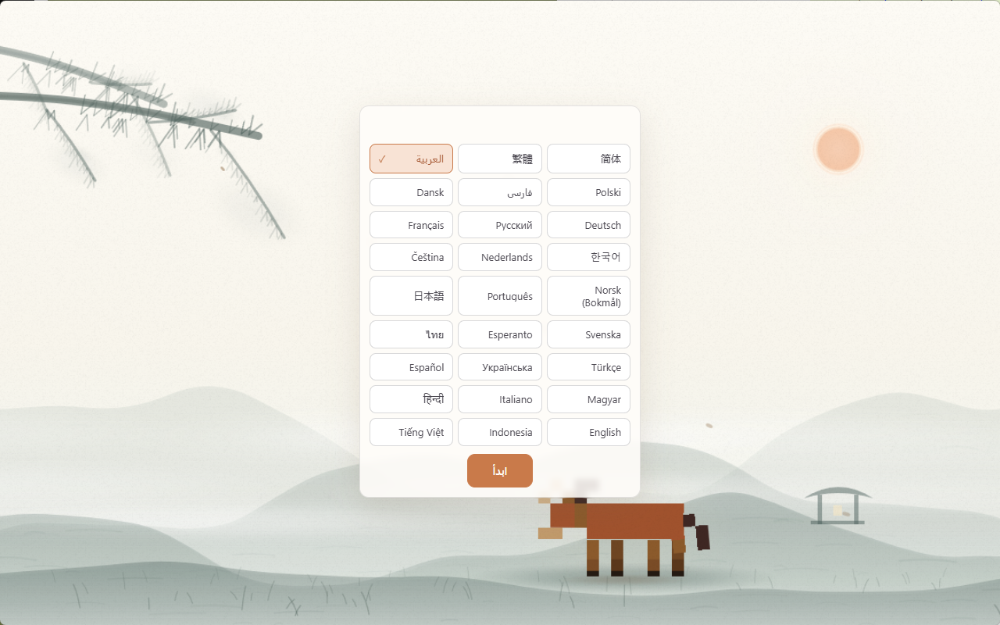
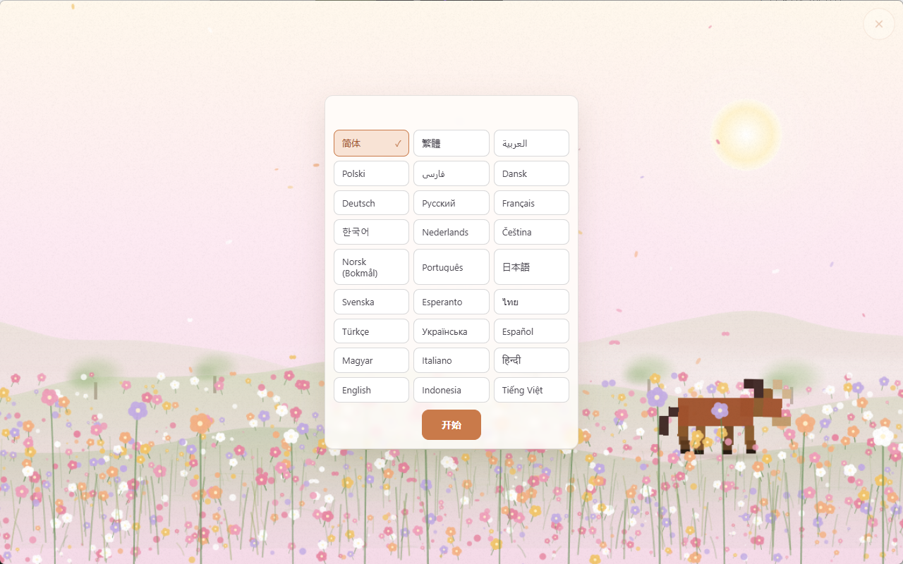
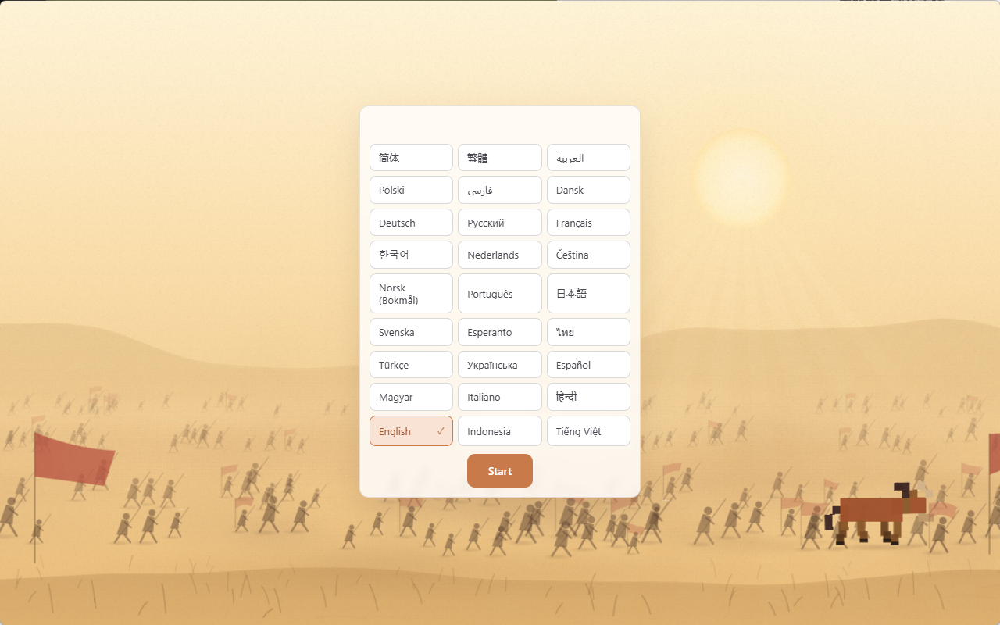
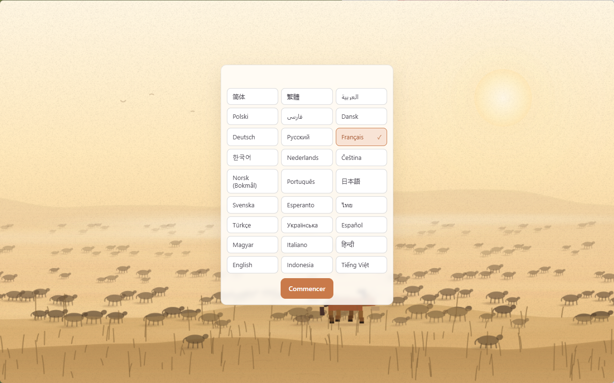

# WArmy · 无限牛马

**WArmy = Workhorse Army.** *An army that's yours.*

### Put a small AI team on your desktop.

Give one workhorse the research, another the draft, and a third the review. Keep their conversations, plans and finished files together in WArmy. Choose the models they use and the work they are allowed to do.

WArmy is a local-first desktop workspace for people carrying a project from brief to deliverable. Bring your own local or cloud models; cloud usage is billed by your provider.

[Download for Windows](https://github.com/Pondsi/WArmy/releases) · [Chinese manual](./说明.md) · [Acknowledgments](#acknowledgments) · [License](#documentation-and-license)

---

## Scenes worth trying

### Turn a folder of notes into a report you can review

"Read these meeting notes, draft the project update, then check each decision against the source."

Ask a researcher to find the evidence, a writer to prepare the report, and a reviewer to flag gaps. Open the resulting documents beside the conversation and keep the unresolved items on the plan board. Each role can use a different model.

### Pick up a long-running project next week

"What did we agree about delivery last time? Show me the original discussion."

Keep a project conversation and its knowledge together. Summaries help you find decisions and pending work; source links let you return to the original record. Older details can be retrieved when needed instead of being pasted into every prompt.

### Give a small studio separate workhorses for separate jobs

"Prepare the proposal. Have another workhorse review the costs before I send it."

Choose a role, instructions and model chain for each workhorse. Use a project room for shared work, a private assistant for your own files, and contacts for conversations with other people. Set permissions for each session.

### Keep models and finished work within reach

Use a local model for work you want to keep on your machine. Add a cloud model when its capabilities suit a task. The file viewer handles drafts, documents and a tabbed browser; the console lets you run commands in the session workspace. Access outside that workspace depends on the permissions you grant.

### Turn an answer into a checklist you can use

"Give me a launch checklist I can tick off, with a place for notes."

The normal reply appears first. When **Reply boost** is enabled in the chat's three-dot menu, WArmy adds an interactive layer after the text settles. Open it in the nm viewer, or in your system's default app when nm is not enabled. The interactive result stays with that conversation.

## What you get

- **A team you can configure.** Separate roles, instructions and model chains for researchers, builders and reviewers. A duty agent can coordinate project work.
- **A place for work in progress.** Conversations, plans, knowledge and output files stay linked to the session.
- **Memory you can inspect.** Search earlier work, open source records, and edit the knowledge used by the team. Summaries are navigation aids, not proof that a fact is correct.
- **A choice of models.** Connect local, self-hosted or cloud endpoints. You control which models are enabled and can select one explicitly.
- **A desktop companion.** Customize its appearance and interaction. Camera, microphone, speaker and network controls are separate.
- **Interactive replies.** Keep the readable answer, then add a checklist, form or other interactive content when you want it. The menu entry keeps its familiar name, **Reply boost**.
- **Optional desktop control.** Connect an external Computer Use MCP server for window listing, screenshots, clicks, typing, dragging and scrolling. It is off by default; sensitive actions ask again each time.

Model output still needs review. Different models and services support different tools, document formats and media capabilities.

## Your account, your keys

Create a local identity, save its 24-word mnemonic, and set a PIN. WArmy does not run an account-recovery service. Keep the mnemonic privately: it is needed to recover your identity, and sharing it gives someone else access.

Your workspace data is stored on your machine. A cloud model receives the prompts and attachments sent to it. Network discovery and optional integrations have their own data boundaries, described below and in the [privacy notice](docs/PRIVACY.md).

## What you can do

Use voice input, read documents, browse sources, prepare Office files and follow a plan through tool calls. Add skills, plugins or MCP connections for tasks beyond the built-in tools. Local speech and other optional capabilities may need additional components.

For recurring work, configure scheduled tasks and exports. For shared work, use contacts, project networking, remote-operation permissions and multi-device sync. Availability depends on reachable devices, service accounts and the integrations you configure. Computer Use requires a separately installed compatible MCP server; WArmy does not bundle one.

Workhorses can suggest a next step through self-drive, which is enabled per session by default and can be switched off. Proposals have output checks and ask for your decision; they do not grant themselves new permissions. Optional self-evolution and feedback-based tuning are experimental, and can produce changes that need review.

## Control and safety

- Choose permissions per session. Normal permission mode asks for approval where required; full permission mode permits more actions automatically. Use it only when you trust the task and its tools.
- A group conversation does not automatically gain access to private sessions or their files. Protected application and account paths have additional restrictions.
- Choose a host or container workspace. Container use requires a working container environment.
- Control device access separately. Active conversation use takes priority over the desktop companion.
- Computer Use has its own authorization. Full permission mode does not silently approve desktop control. WArmy models see only the six mapped capabilities; the external server remains third-party software you must trust.

Review generated files before sharing them. Output checks can catch specific problems; they cannot establish that every answer is accurate or that every action is safe.

## How it works

Describe the result you need and attach the relevant material. Select a workhorse or use a project room to divide the work. Follow the plan, respond to approval requests, then open and review the output files.

Keep instructions in the session's requirements and use source records to check a disputed fact. The [Chinese manual](./说明.md) covers setup, permissions, tools and recovery.

## The system and your data

WArmy stores its workspace locally and uses the model endpoints you configure. Connecting a cloud endpoint sends selected conversation context, instructions and attachments to that provider. Interactive replies make an additional call to the provider used for the normal reply, sending the question and reply text. Web search, social adapters and remote operations also contact their configured services.

DHT discovery is enabled by default and can be switched off in Settings → Network & Host. It publishes address, port, identity fingerprint and online-time metadata, not chat content. LAN and relay networking are optional. Review these settings before using WArmy for confidential work.

## Small details and technical notes

The conventional local service port is **59599**. Network reachability and remote-operation permissions are configured separately. See the [privacy notice](docs/PRIVACY.md) and [terms](docs/TERMS.md) before connecting third-party services.

## Install

Install WArmy, then connect the model endpoint you want to use.

1. Download `WArmy-Setup-0.4.53.exe` from the [latest release](https://github.com/Pondsi/WArmy/releases).
2. Run the installer, choose a folder, launch **WArmy / 无限牛马**.
3. First run: choose a language, create your self-custodied identity, save the 24-word mnemonic, set a PIN; add a model provider and create your first workhorse.

Data lives in `WArmyData` inside the install folder and survives upgrades/uninstall. The installer is unsigned (SmartScreen may warn); the release page lists SHA-256 for verification.

**Environment:** Windows 10/11 x64 and a compatible model endpoint (Ollama, OpenAI-compatible, or Anthropic). Add the endpoint address and any credentials it requires. Running a local model requires suitable hardware; WArmy does not include a general-purpose language model.

**Languages / 语言 — 27 UI languages:** 简体中文 · 繁體中文 · English · 日本語 · 한국어 · Русский · Español · Français · Português · Esperanto · Deutsch · Italiano · Nederlands · Polski · Svenska · Čeština · Magyar · Dansk · Norsk bokmål · Türkçe · Українська · Bahasa Indonesia · Tiếng Việt · ไทย · हिन्दी · العربية · فارسی.

## Status and honesty

Windows x64 is the published desktop target. Other platforms and third-party integrations require their own compatibility checks. Local storage does not by itself mean offline use: discovery, models, update checks and integrations may contact external services.

AI-generated content can be incomplete or wrong. Keep backups of important files, inspect proposed changes and use the permissions appropriate to the task. Improvements measured in a test do not guarantee better results on every future task.

## Acknowledgments

WArmy stands on open-source work. Resolved dependency versions are listed in `pnpm-lock.yaml`; package manifests and bundled upstream notices identify their licenses. The main projects are linked below.

**Bundled runtime & UI** (ordered by share of use)

- **DeepSeek Harness (dsh)** — MIT — <https://github.com/deepseek-ai/deepseek-harness> — the agent harness WArmy builds on: bundled runtime + plugin-first compatibility. Companions: **@nanmicoder/dsh-agent-teams** — <https://www.npmjs.com/package/@nanmicoder/dsh-agent-teams>; **node-pty** — MIT — <https://github.com/microsoft/node-pty>; **koffi** — MIT — <https://github.com/Koromix/koffi>; **protobufjs** — BSD-3-Clause — <https://github.com/protobufjs/protobuf.js>; **@google/genai** — Apache-2.0 — <https://github.com/googleapis/js-genai>.
- **Electron** — MIT — <https://github.com/electron/electron>; **Chromium** — BSD-3-Clause — <https://github.com/chromium/chromium>; **Node.js** — MIT — <https://github.com/nodejs/node> — the desktop shell and runtime (a bundled `node.exe` runs the memory service in its own process).
- **SQLite** — Public Domain — <https://www.sqlite.org/>; **better-sqlite3** — MIT — <https://github.com/WiseLibs/better-sqlite3>; **better-sqlite3-multiple-ciphers** — MIT — <https://github.com/m4heshd/better-sqlite3-multiple-ciphers>; **SQLCipher** — BSD-style — <https://github.com/sqlcipher/sqlcipher>; **bindings** — MIT — <https://github.com/TooTallNate/node-bindings>; **file-uri-to-path** — MIT — <https://github.com/TooTallNate/file-uri-to-path> — the memory store (FTS5 + optional encryption, subprocess only).
- **Diwen** — own license — <https://github.com/Pondsi/dsh-diwen> — separate open-source structured fact layer (also on npm as `diwen`).
- **hash-wasm** — MIT — <https://github.com/Daninet/hash-wasm> — argon2id/hashing in pure WASM (identity & keys).
- **franc-all** — MIT — <https://github.com/wooorm/franc> — language detection for the AI output-language guard (with **trigram-utils**, **collapse-white-space**, **n-gram**, all MIT).
- **three.js** — MIT — <https://github.com/mrdoob/three.js>; **@pixiv/three-vrm** — MIT — <https://github.com/pixiv/three-vrm> — 3D/VRM rendering for the mimic (license text bundled beside the vendor bundle).
- **ONNX Runtime Web** — MIT — <https://github.com/microsoft/onnxruntime> — local embeddings via WASM SIMD/WebGPU.
- **sherpa-onnx / sherpa-onnx-node** — Apache-2.0 — <https://github.com/k2-fsa/sherpa-onnx> — local speech (subprocess only).
- **DuckDB** — MIT — <https://github.com/duckdb/duckdb> + **@duckdb/node-api** — MIT — <https://github.com/duckdb/duckdb-node-neo> — local analytics (subprocess only).
- **qrcode-generator** — MIT — © Kazuhiko Arase — <https://github.com/kazuhikoarase/qrcode-generator>; **jsQR** — Apache-2.0 — <https://github.com/cozmo/jsQR> — QR encode/decode.

**Companion projects**

- **FWArmy** — <https://github.com/Pondsi/FWArmy> — the companion **relay service station** for WArmy: deploy a voluntary public relay site for the community, or run a private one for your own team. It pairs with WArmy's optional relay networking when direct connections aren't possible.

**Build & installer**

- **TypeScript** — Apache-2.0 — <https://github.com/microsoft/TypeScript>; **pnpm** — MIT — <https://github.com/pnpm/pnpm>; **electron-builder** — MIT — <https://github.com/electron-userland/electron-builder>; **esbuild** — MIT — <https://github.com/evanw/esbuild>; **NSIS** — zlib/libpng-style — <https://nsis.sourceforge.io/>.

**On-demand subprocess tools** (downloaded/installed only with consent, hash-pinned)

- **whisper.cpp** — MIT — <https://github.com/ggml-org/whisper.cpp>; **TripoSR** — MIT — <https://github.com/VAST-AI-Research/TripoSR> on **PyTorch** — BSD-3-Clause — <https://github.com/pytorch/pytorch> under **Python** — PSF — <https://www.python.org/>, weights from **Hugging Face** — <https://huggingface.co/>; **Docling** — MIT — <https://github.com/docling-project/docling>; **Tree-sitter / web-tree-sitter** — MIT — <https://github.com/tree-sitter/tree-sitter>.

**Protocols & optional external services** (own licenses/terms)

- **A2UI** — Apache-2.0 — <https://github.com/a2ui-project/a2ui> — official `@a2ui/agent`, `@a2ui/lit` and `@a2ui/web_core` packages power the optional interactive reply layer.
- **Model Context Protocol** — <https://modelcontextprotocol.io/> (bundled mcp-bridge implements the stdio JSON-RPC contract); **Ollama** — MIT — <https://github.com/ollama/ollama>; **ComfyUI** — GPL-3.0 — <https://github.com/comfyanonymous/ComfyUI>; **LibreOffice** — MPL-2.0 — <https://www.libreoffice.org/>; **WPS / Office** — proprietary — <https://www.wps.com/>.
- Every other dependency retains its own copyright/license; keep upstream notices when redistributing.

**无限牛马** is the Chinese name. The pixel ox is the mascot. The work is the point.

## Documentation and license

- [说明.md](./说明.md): full Chinese manual.
- [LICENSE](./LICENSE): Pondsi Attribution License — any use (original, modified, snippets, personal or distributed) is allowed with a single condition: credit **Pondsi**. No repository link or full-license retention is required. Third-party dependencies, model weights and assets keep their own licenses.
- [SPONSORS.md](./SPONSORS.md): support the project.
- [Issues](https://github.com/Pondsi/WArmy/issues): bug reports and feature requests.