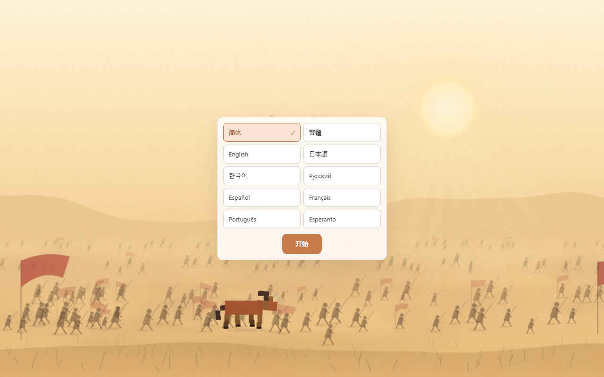

# WArmy

**无限牛马 · Workhorse Army**

### An army that's yours.

**Your private AI team — on your machine, under your rules.**

WArmy is a local-first desktop workspace for people who use AI as more than a chat box. Give each workhorse a role, a persona, and a model. A duty agent assigns the work. A shared board keeps the plan, the artifacts, and the open questions in one place. A local memory service remembers what happened, and points back to the original record instead of replaying the whole conversation.

Use it as a private assistant, as a private team of experts, or as a shared project room where people and agents work on the same brief. Your workspace, chats, files, and memory stay on your machine by default. Cloud models, web search, networking, and IM adapters are explicit choices, never background defaults.

[Download for Windows](https://github.com/Pondsi/WArmy/releases/tag/v0.2.33) · [Chinese manual](./说明.md) · [How it works](#how-it-works)

[](https://github.com/Pondsi/WArmy/releases/tag/v0.2.33)
[](./LICENSE)
[](https://github.com/Pondsi/WArmy/releases)
[](https://www.electronjs.org/)
[](https://nodejs.org/)
[](#small-details)



*First launch. Ten UI languages, one workspace.*

---

It is 11 p.m. One chat wrote the plan. Another wrote the code. A third has no idea why any of it exists. You paste the same background into every window and hope the next one remembers.

WArmy keeps the team in one workspace. The plan, the board, the files, and the memory survive the window. And because the workspace is yours, the default path does not go through someone else's server.

## Three ways to use WArmy

| You want | WArmy gives you | What stays local |
| --- | --- | --- |
| **A private assistant** | One workhorse with your files, your tools, and your model. It can read, search, write, and run commands after you approve them. | The workspace, memory, audit trail, and model endpoint choice. |
| **A private expert team** | A product manager, a builder, a reviewer, and a writer. The duty agent routes the brief, the board records decisions, and memory carries the context forward. | Every role, model, project file, board entry, and memory record. |
| **A shared project room** | People and workhorses in one project or group chat. Roles, approvals, artifacts, and a project-level paper trail. Optional LAN, DHT, and relay networking when you turn it on. | Project data on each participant's machine; only the messages and artifacts you choose to share cross the network. |

One person can use all three. A small studio can start with the assistant and grow into the project room without moving the work to a hosted platform.

## Why WArmy

### Local-first is the architecture, not a slogan

- **Your data lives on your disk.** Chats, projects, the board, artifacts, memory, and settings are stored in `WArmyData` next to `WARMY.exe` in the install folder you choose. There is no WArmy account and no WArmy cloud.
- **Local models are first-class.** Point WArmy at any local or self-hosted endpoint that speaks a supported protocol. Enter the base URL and model name; add a key only if the server asks for one.
- **The network layer is off until you turn it on.** LAN discovery, direct connections, DHT discovery, relays, and IM adapters are explicit options. Sharing a project is a decision, not a default.
- **Memory is a local service, not a transcript pile.** An append-only JSONL log is the source of truth; SQLite holds a rebuildable FTS5 projection with optional vectors. `recall` finds evidence cards and `retrieve` returns the original bytes.
- **The work survives interruption.** A long task can stop with a stated reason, keep what was produced, and continue later. P0 to P3 queues persist across restarts.

Local-first does not mean "nothing ever leaves the machine". It means the default is local, and every outbound path is visible: a cloud model receives the prompt you send it, a configured search provider receives the query, and a connected IM platform receives its messages. The rest stays on your disk.

### Private-first in practice

- **No analytics SDK, no ad SDK, no silent upload.** WArmy contacts GitHub for update checks and only the providers and services you configure. Crash logs stay on your machine.
- **Secrets use OS secure storage.** Model API keys, the identity key, the mnemonic, and social credentials are kept through the platform's secure storage. The UI never reads a saved key back into the DOM.
- **Logout seals the local data store.** The vault uses AES-256-GCM with a scrypt-derived key and a one-time session token after unlock.
- **Search respects the same boundary.** Local search results can show sensitive values only as `*****` by default; hovering reveals a short-lived copy from main-process memory, and moving away masks it again. Search is read-only.
- **Permissions are per session.** Knowledge layers, workspace access, and cross-session reads have separate rules. A group-chat workhorse cannot browse a project or a private workhorse session just because it can chat.

Honest boundary: most workspace files are plaintext while the app is unlocked, and a cloud model provider receives whatever you send it. Full at-rest protection still depends on your OS account, disk encryption, and the provider you choose.

### Secure-first by construction

- **One IPC surface, checked twice.** Business IPC accepts only the app's own main window and the nm viewer, requires the main frame, and validates payloads against schemas.
- **Dangerous actions stop at a card.** Shell commands, writes outside the workspace, protected directories, other-session data, and full-disk model searches require an explicit approval unless the user has chosen full authorization for that scope.
- **Every tool call is auditable.** Tool calls, permission decisions, model changes, exports, and network handshakes leave an audit trail.
- **Claimed artifacts are verified on disk.** The host checks that a file an agent says it created actually exists before the board treats it as done.
- **Optional isolation.** Workhorses can run on the host or in a container; an unavailable container is reported as unavailable, not silently replaced with the host.
- **Updates are checked, not blindly installed.** The app verifies update metadata and packages; it does not install automatically.

No software is "unhackable". WArmy does not claim a third-party security certification or a penetration-test badge. The design goal is narrower and testable: local by default, explicit before dangerous actions, and honest when a boundary is hit.

### Memory that makes a team feel like a team

A new chat window forgets everything. A team cannot. WArmy treats memory as a local service with two jobs: find the right evidence, and return the original record when the model needs it.

- The append-only log is the source of truth.
- SQLite is a rebuildable projection, not the only copy.
- Full-text and optional vector channels are fused with reciprocal rank fusion.
- Every recalled card carries a pointer back to the original message.
- If the memory service is unavailable, tools fail honestly instead of inventing history.

### Your models, not a locked-in model

Bring a local model, a self-hosted server, an OpenAI-compatible endpoint, or Anthropic. The API key field stays empty when the server does not require one. Capability metadata (context window, vision, tools) is attached to each model so routing and budgets do not guess.

## What you get

| The problem | What WArmy does |
| --- | --- |
| Every chat starts cold | A project keeps its plan, board, artifacts, and history after a restart |
| You hand-address every message | A duty agent picks the worker, sets the thinking level, and dispatches one worker at a time |
| Agents claim a file they did not write | The host checks every claimed artifact against the file system |
| A long task dies at 90 percent | It can stop with a stated reason, keep what was produced, and continue later |
| Memory is a pile of old chats | Memory is a queryable local service with pointers back to the original messages |
| The cloud is the only option | Local and self-hosted model endpoints are first-class; cloud is optional |
| A shared project turns into a folder of screenshots | The board, artifacts, decisions, and audit trail stay with the project |

**You bring the models. WArmy brings the organization.**

## What you can do

**Keep a private assistant that knows your files.** Point it at a local model, give it a workspace, and let it read, search, draft, and organize. Sensitive values stay masked in search; dangerous actions stop at an approval card; everything it does is written to an audit trail.

**Run a private expert team.** Give the project a product manager, a builder, a reviewer, and a writer. A brief like "Draft the launch note from these three files, then have the reviewer check the claims" gets routed, executed, and checked. The builder writes files, the reviewer reads them, and the board records decisions and open questions.

**Open a project room for people and agents.** Invite collaborators to a project or group chat. People bring their own models and their own machines; the project keeps roles, membership, artifacts, and decisions. Turn on optional networking when the team is on the same LAN or reachable peers; keep it off when it is not.

**Research and write.** Search the web, extract pages, read PDFs and Office files, draft a document, check claims, and archive the result. The next session can recall the sources by pointer instead of replaying the whole conversation.

**Run recurring operations.** Schedule tasks and exports. Watch long-running processes. Keep an audit trail of tool calls and permission decisions.

**Keep sensitive work local.** Run a local model server on `127.0.0.1` and the model stays on your machine. Use any server that speaks a supported protocol; enter its base URL, and add a key only if the server requires one.

**Inspect what the agents made.** The built-in nm viewer opens Markdown with source and preview, extracts Office and PDF content, edits binary files byte by byte, browses archives, and doubles as a tabbed browser with a per-tab split view.

## One workspace, more than one device

WArmy is designed to be one workspace across your devices, not a different silo on every machine. The current release is **single-machine** for account data, with optional project networking between machines that can reach each other. Account-level record sync is the next milestone, and it will be called out in the release notes when it ships.

The direction is deliberately different from a hosted sync service:

- **No mandatory account server.** Devices pair directly, discover each other when possible, and use a relay only when the network cannot connect them.
- **End-to-end encryption by default.** A relay forwards ciphertext; it does not get a readable copy of chats, files, or memory.
- **Device-level trust.** A new device is enrolled with a one-time pairing code and its own device key. The mnemonic is not copied to every device.
- **A record log, not a magic folder.** Chats stay append-only. Editable state uses explicit merge rules. Files become immutable versions instead of silent overwrites.
- **Offline is normal.** A device that was away syncs when it returns. A small encrypted mailbox can hold envelopes for devices that are not online at the same time.

This is a design commitment, not a claim that every part is finished. The roadmap is: device pairing and signed device list first, then encrypted record sync for chats, memory, and the board, then encrypted file versions, then live multi-writer collaboration. We will not label it "done" until it has passed real multi-device, network-partition, replay, and revocation tests.

## The system

### Workhorses with identity

Each workhorse has a name, a persona, a model, and its own fallback chain. The model carries capability metadata such as context window, vision, and tool support, so WArmy can route work and budget context without guessing. A reviewer with a different persona and a different model gives you a second opinion, not a rerun.

### A duty agent assigns the work

Projects have a duty agent. Send a brief with an urgency level and the duty agent decides who handles it. Work can arrive as a normal turn, an urgent insert, or a queued item. P0 to P3 queues persist across restarts, so a busy evening does not erase the morning's queue.

### A board and a blackboard

Workers dispatched for the same task share an append-only task blackboard: facts, decisions, artifacts, and open questions. The host stamps the source of each entry, stores it in memory with a real record ID, and verifies claimed files. Workers return a structured handback with a hard-capped conclusion and a list of artifacts. A long task does not restart from zero when a second worker joins.

### Memory you can inspect

The memory service treats an append-only JSONL log as the source of truth. SQLite holds a rebuildable projection with unigram and trigram full-text indexes plus an optional vector channel. Models get two tools: `recall(query)` finds evidence cards, and `retrieve(seq|recordId)` returns the original bytes. If the service is unavailable, those tools fail with an honest error instead of inventing history.

### Context that covers the whole request

The context budget covers everything sent to the model: system rules, tool specs, the visible history, the current turn, late-injected ledgers, and images priced by real pixels. Token counts are calibrated per provider, model, and density bucket from the provider's own usage numbers. When a request does not fit, a fixed ladder summarizes, splits, downscales, compresses, and finally stops with a concrete reason plus Continue and Retry.

### Tools that finish the job

WArmy ships more than 40 built-in tools: file operations, shell commands, document creation and reading (DOCX, PPTX, XLSX, PDF), web search and extraction, image and video generation through ComfyUI when you connect it, subagents, schedules, process monitoring, and LSP diagnostics. Shell commands go through permission prompts, and tool calls are written to an audit log.

### Search you can control

Web search is built in but **off by default**. Open **Settings → Functions → Web search** and enable at least one provider: Firecrawl Keyless, Tavily, DeepSeek search, or a custom HTTP endpoint. Jina Reader is available as an extraction provider, not a search provider. Keys are stored through OS secure storage; a provider that returns 429 is reported as rate-limited with a choice of wait, switch provider, or stop.

The search box in the chat header searches in order: the current session, every visible label in the app, other sessions, the knowledge base, then local disks. The local disk index is built in the background (on by default) and indexes file names/paths for every file, then adds masked content later. Results are paged as you scroll; when a scan or index reaches its current end, the UI says so instead of pretending it is complete. Sensitive values are masked as `*****`; hovering reveals a short-lived copy and moving away masks it again.

Models get a scoped `local_search` tool. It can read the current session, permitted knowledge layers, and the session workspace. Cross-session reads require an approval card: My Workhorses may read other sessions; project workhorses may read only projects and group chats; group-chat and contact workhorses are denied with no authorization path. Full-disk model search is limited to My Workhorses and requires a separate approval card.

### A workbench for the output

The nm viewer is a separate window that snaps to the main window. It handles Markdown with draggable source and preview panes, HTML and SVG previews, DOCX, PDF, PPTX, and XLSX extraction, a hex editor for binary files, and archive trees. Browser mode adds tabs, a new-tab toggle for links, per-tab split layouts, a read-only source view for remote pages, and downloads. You can check the work without leaving the app.

### Models and optional networking

Bring a local or self-hosted model that speaks a supported protocol, an OpenAI-compatible endpoint, or Anthropic. Enter the base URL and model name; the API key field stays empty when the server does not require one. WArmy handles tool calls, streaming, usage accounting, and fallback. The network layer is optional: LAN discovery, NAT-PMP and STUN for direct connections, opt-in DHT discovery, X25519 key agreement with Ed25519 signatures, a delivery outbox with business ACKs, signed invitations, and join approval. A small team on the same LAN can share a project without standing up a server.

<details>
<summary id="small-details">Small details and technical notes</summary>

- Desktop shell: Electron 45.1.0, TypeScript, pnpm workspace.
- Model protocols: OpenAI-compatible, Anthropic, and Ollama native. Enter the base URL; the API key is optional when the endpoint does not require one.
- Languages / 语言: 简体中文 · 繁體中文 · English · 日本語 · 한국어 · Русский · Español · Français · Português · Esperanto.
- Light and dark themes, 4K-aware layout. Physical 4K verification is still pending.
- Local memory database: SQLite with FTS5, optionally SQLCipher-encrypted through `better-sqlite3-multiple-ciphers`.
- Full-disk search index: Node's built-in SQLite + FTS5, stored under `WArmyData/search-index`.
- Vault: AES-256-GCM; key derivation with scrypt; one-time session token after unlock.
- Network transport: X25519 key agreement, Ed25519 signatures, HKDF-SHA256. Mesh ports: 59599 production, 58588 dev, 62666 test.
- Data directory: `WArmyData` next to `WARMY.exe` in the chosen install directory.

</details>

## How it works

1. **Add a provider.** Point WArmy at a local model server, an OpenAI-compatible endpoint, or Anthropic. Enter the base URL and model; the key is optional for servers that do not require one.
2. **Create workhorses.** Pick a persona and a model for each role.
3. **Create a project.** Add members and choose a duty agent.
4. **Send a brief.** Mark urgency and difficulty. The duty agent dispatches a worker with tools and a budget.
5. **Review and keep.** Open the artifacts in nm, check the board, then archive the result into memory.

## Install

### Windows 10 or 11, x64

1. Open the [v0.2.33 release](https://github.com/Pondsi/WArmy/releases/tag/v0.2.33).
2. Download `WArmy-Setup-0.2.33.exe`.
3. Run the installer and launch **WArmy / 无限牛马**.

The installer lets you choose the installation folder. WArmy stores its data in `WArmyData` inside that folder, and keeps that folder when you uninstall or upgrade. The installer is not code-signed. Windows SmartScreen may show an unknown publisher warning. The release page lists the SHA-256 so you can verify the download. WArmy is free under the MIT license with attribution. You pay your model provider directly.

### First run

Choose a language, accept the terms, create an identity, and save the 24-word mnemonic. Then add a provider and create your first workhorse. For a local server, start it, enter its base URL, and pick a model. Leave the key empty when the server does not require one.

## Status

0.2.33 runs on Windows 10 and 11 x64. Core workflows are verified with local model servers. Three consecutive rounds of the offline gate suite plus the first-run, search-provider, full-disk index, sensitive-reveal, and lazy-loading checks passed with zero failures. macOS, physical 4K, real IM accounts, and cloud providers are still being verified.

Account-level multi-device record sync is not shipped yet. The current release supports optional project networking between reachable machines. The installer is unsigned. Most workspace files are plaintext while the app is unlocked. Model output can be wrong, so review artifacts before shipping them.

## Build from source

Requirements: Node.js 24 or newer and pnpm 10.23.

```bash
git clone https://github.com/Pondsi/WArmy.git
cd WArmy
pnpm install
pnpm build
pnpm --filter @warmy/app-shell start
```

## FAQ

**Do I need a cloud account?**
No. WArmy has no server-side account. You bring your own model provider.

**Can it run offline?**
Yes with a local model server. Web search, page extraction, cloud models, and IM connections need network access.

**Where does my data live?**
In `WArmyData` next to `WARMY.exe` in the install directory you chose. On the first launch after upgrading, WArmy copies the old `%APPDATA%\@warmy\app-shell` data into `WArmyData` and leaves the old folder as a backup. You can export chats and a vault backup, and you can delete `WArmyData` to erase local data.

**Does WArmy sync across devices?**
Not yet at the account level. The current release can connect machines for project networking when you enable it. Device pairing and end-to-end encrypted record sync are the next milestone, and they will be documented as soon as they are usable.

**Does WArmy send telemetry?**
The app includes no analytics SDK. It contacts GitHub for update checks, and it contacts only the providers and services you configure. Crash logs stay on your machine.

**Can I use it commercially?**
Yes, under the MIT license with mandatory attribution to Pondsi. See [LICENSE](./LICENSE).

**Is this an IDE?**
No. It is a project command center that can read and write files and run commands with your approval.

**Does it work on macOS?**
Not yet. The current release targets Windows x64.

## Acknowledgments

WArmy stands on open-source work. The main components are listed below; the complete transitive dependency tree, with each package's own license, is recorded in `pnpm-lock.yaml` and the package manifests.

- **DeepSeek Harness (dsh)** — MIT — [deepseek-ai/deepseek-harness](https://github.com/deepseek-ai/deepseek-harness). WArmy bundles the dsh runtime (`@deepseek-ai/dsh` 0.1.5-rc.1) for the optional dsh execution path. Its plugin-first harness design shaped how we think about a host that stays in control while agents stay extensible. Thank you to the DeepSeek team and contributors.
- **Electron** — MIT — [electronjs.org](https://www.electronjs.org/). The desktop shell.
- **Chromium** — BSD-3-Clause — the rendering engine inside Electron.
- **Node.js** — MIT — the runtime for the main process and local services.
- **TypeScript** — Apache-2.0 — the language used across the monorepo.
- **pnpm** — MIT — the workspace package manager.
- **electron-builder** — MIT — Windows installer and packaging.
- **SQLite** — Public Domain — the local database engine, including FTS5.
- **better-sqlite3** — MIT — the SQLite binding used by the memory service.
- **better-sqlite3-multiple-ciphers / SQLCipher** — MIT / BSD-style — optional encryption for the memory database.
- **ONNX Runtime Web** — MIT — optional local embedding runtime.
- **sherpa-onnx** — Apache-2.0 — optional local speech recognition and synthesis.
- **qrcode-generator 2.0.4** — MIT — © 2009 Kazuhiko Arase — QR encoding (vendored).
- **jsQR 1.4.0** — Apache-2.0 — QR decoding (vendored).
- **Ollama**, **ComfyUI**, and other model servers or creative tools are optional external services, not bundled code; their own licenses and terms apply.
- Every other dependency retains its own copyright and license. If you redistribute WArmy, keep the upstream notices and license texts.

**无限牛马** is the Chinese name. The pixel ox is the mascot. The work is the point.

## Documentation and license

- [说明.md](./说明.md): full Chinese manual.
- [LICENSE](./LICENSE): MIT with attribution.
- [SPONSORS.md](./SPONSORS.md): support the project.
- [Issues](https://github.com/Pondsi/WArmy/issues): bug reports and feature requests.
