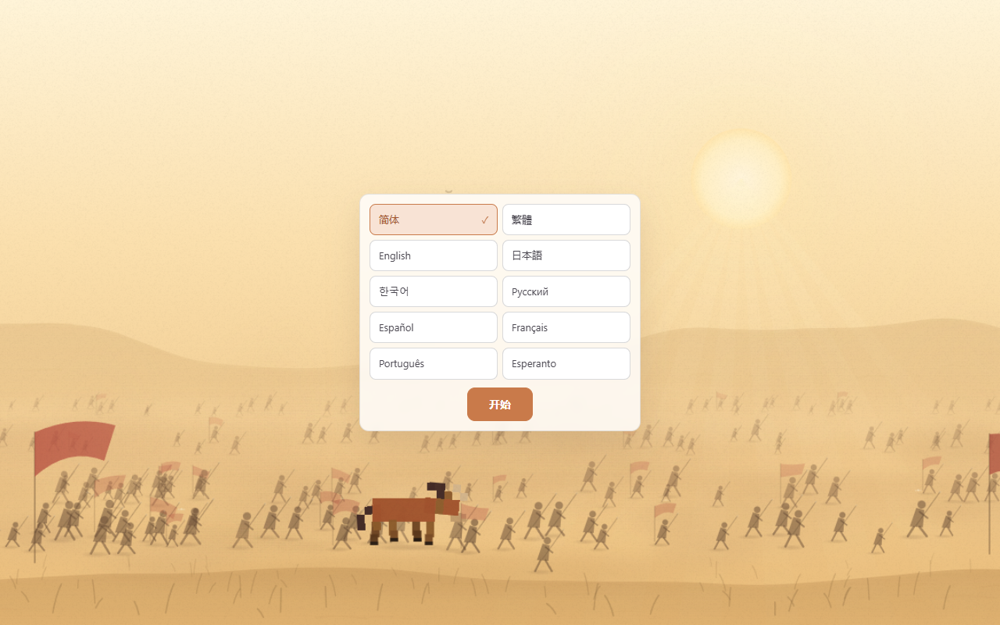

# WArmy

**无限牛马** · Workhorse Army

### Your AI work has a team now.

WArmy is a local-first desktop command center for AI workhorses. Give each agent a role and a model. A duty agent assigns the work, a shared board keeps it moving, and a local memory service remembers what happened. Run it with Ollama on your machine or your own cloud provider, and keep the workspace on your disk by default.

[Download for Windows](https://github.com/Pondsi/WArmy/releases/tag/v0.2.30) · [Chinese manual](./说明.md) · [How it works](#how-it-works)

[](https://github.com/Pondsi/WArmy/releases/tag/v0.2.30)
[](./LICENSE)
[](https://github.com/Pondsi/WArmy/releases)
[](https://www.electronjs.org/)
[](https://nodejs.org/)
[](#small-details)



*First launch. Ten UI languages, one workspace.*

---

It is 11 p.m. One chat wrote the plan. Another wrote the code. A third has no idea why any of it exists. You paste the same background into every window and hope the next one remembers.

WArmy keeps the team in one workspace. The plan, the task board, the files, and the memory survive the window.

## What you get

| The problem | What WArmy does |
| --- | --- |
| Every chat starts cold | A project keeps its plan, board, artifacts, and history after a restart |
| You hand-address every message | A duty agent picks the worker, sets the thinking level, and dispatches one worker at a time |
| Agents claim a file they did not write | The host checks every claimed artifact against the file system |
| A long task dies at 90 percent | It can stop with a stated reason, keep what was produced, and continue later |
| Memory is a pile of old chats | Memory is a queryable service with pointers back to the original messages |

**You bring the models. WArmy brings the organization.**

## What you can do

**Ship a small product.** Give the project a product manager, a builder, a reviewer, and a writer. A brief like "Draft the launch note from these three files, then have the reviewer check the claims" gets routed, executed, and checked. The builder writes files, the reviewer reads them, and the board records decisions and open questions.

**Research and write.** Search the web, extract pages, read PDFs and Office files, draft a document, check claims, and archive the result. The next session can recall the sources by pointer instead of replaying the whole conversation.

**Run recurring operations.** Schedule tasks and exports. Watch long-running processes. Keep an audit trail of tool calls and permission decisions.

**Keep sensitive work local.** Point WArmy at Ollama on `127.0.0.1` and the model runs on your machine. Cloud providers are optional.

**Coordinate more than one machine.** Turn on the optional network layer to join projects across devices, or connect the IM adapters (WeChat, WeCom, DingTalk, Telegram, Feishu) to bring messages into a project. Every network feature is off until you configure it.

**Inspect what the agents made.** The built-in nm viewer opens Markdown with source and preview, extracts Office and PDF content, edits binary files byte by byte, browses archives, and doubles as a tabbed browser with a per-tab split view.

## The system

### Workhorses with identity

Each workhorse has a name, a persona, a model, and its own fallback chain. The model carries capability metadata such as context window, vision, and tool support, so WArmy can route work and budget context without guessing. A reviewer with a different persona and a different model gives you a second opinion, not a rerun.

### A duty agent assigns the work

Projects have a duty agent. Send a brief with an urgency level and the duty agent decides who handles it. Work can arrive as a normal turn, an urgent insert, or a queued item. P0 to P3 queues persist across restarts, so a busy evening does not erase the morning's queue.

### A board and a blackboard

Workers dispatched for the same task share an append-only task blackboard: facts, decisions, artifacts, and open questions. The host stamps the source of each entry, stores it in memory with a real record ID, and verifies claimed files. Workers return a structured handback with a hard-capped conclusion and a list of artifacts. A long task does not restart from zero when a second worker joins.

### Memory you can inspect

The memory service treats an append-only JSONL log as the source of truth. SQLite holds a rebuildable projection with unigram and trigram full-text indexes plus an optional vector channel. Models get two tools: `recall(query)` finds evidence cards, and `retrieve(seq|recordId)` returns the original bytes. If the service is unavailable, those tools fail with an honest error instead of inventing history.

### Context that covers the whole request

The context budget covers everything sent to the model: system rules, tool specs, the visible history, the current turn, late-injected ledgers, and images priced by real pixels. Token counts are calibrated per provider, model, and density bucket from the provider's own usage numbers. When a request does not fit, a fixed ladder summarizes, splits, downscales, compresses, and finally stops with a concrete reason plus Continue and Retry.

### Tools that finish the job

WArmy ships more than 40 built-in tools: file operations, shell commands, document creation and reading (DOCX, PPTX, XLSX, PDF), web search and extraction, image and video generation through ComfyUI when you connect it, subagents, schedules, process monitoring, and LSP diagnostics. Shell commands go through permission prompts, and tool calls are written to an audit log.

### A workbench for the output

The nm viewer is a separate window that snaps to the main window. It handles Markdown with draggable source and preview panes, HTML and SVG previews, DOCX, PDF, PPTX, and XLSX extraction, a hex editor for binary files, and archive trees. Browser mode adds tabs, a new-tab toggle for links, per-tab split layouts, a read-only source view for remote pages, and downloads. You can check the work without leaving the app.

### Privacy and safety defaults

WArmy works without a server account. The identity key, mnemonic, model API keys, and social credentials use OS secure storage. Logging out seals the data store with AES-256-GCM and a scrypt-derived key. The IPC layer accepts only the app's own windows and validates payloads against schemas. Mnemonic and PIN screens use OS screen protection where the platform supports it. Most workspace files are plaintext while the app is unlocked, so full at-rest protection still depends on your OS account and disk encryption.

### Models and optional networking

Bring an Ollama model, an OpenAI-compatible endpoint, or Anthropic. WArmy handles tool calls, streaming, usage accounting, and fallback. The network layer is optional: LAN discovery, NAT-PMP and STUN for direct connections, opt-in DHT discovery, X25519 key agreement with Ed25519 signatures, a delivery outbox with business ACKs, signed invitations, and join approval. A small team on the same LAN can share a project without standing up a server.

<details>
<summary id="small-details">Small details and technical notes</summary>

- Desktop shell: Electron 45.1.0, TypeScript, pnpm workspace.
- Languages / 语言: 简体中文 · 繁體中文 · English · 日本語 · 한국어 · Русский · Español · Français · Português · Esperanto.
- Light and dark themes, 4K-aware layout. Physical 4K verification is still pending.
- Local memory database: SQLite with FTS5, optionally SQLCipher-encrypted through `better-sqlite3-multiple-ciphers`.
- Vault: AES-256-GCM; key derivation with scrypt; one-time session token after unlock.
- Network transport: X25519 key agreement, Ed25519 signatures, HKDF-SHA256. Mesh ports: 59599 production, 58588 dev, 62666 test.
- Data directory: `%APPDATA%\@warmy\app-shell` on Windows.

</details>

## How it works

1. **Add a provider.** Use Ollama on your machine, an OpenAI-compatible endpoint, or Anthropic.
2. **Create workhorses.** Pick a persona and a model for each role.
3. **Create a project.** Add members and choose a duty agent.
4. **Send a brief.** Mark urgency and difficulty. The duty agent dispatches a worker with tools and a budget.
5. **Review and keep.** Open the artifacts in nm, check the board, then archive the result into memory.

## Install

### Windows 10 or 11, x64

1. Open the [v0.2.30 release](https://github.com/Pondsi/WArmy/releases/tag/v0.2.30).
2. Download `WArmy-Setup-0.2.30.exe`.
3. Run the installer and launch **WArmy / 无限牛马**.

The installer is not code-signed. Windows SmartScreen may show an unknown publisher warning. The release page lists the SHA-256 so you can verify the download. WArmy is free under the MIT license with attribution. You pay your model provider directly.

### First run

Choose a language, accept the terms, create an identity, and save the 24-word mnemonic. Then add a provider and create your first workhorse. A local Ollama setup needs no API key: start Ollama, point WArmy at `http://127.0.0.1:11434`, and pull a model.

## Status

0.2.30 runs on Windows 10 and 11 x64. Core workflows are verified with local Ollama models. Five of the ten planned acceptance rounds are complete with zero failures. macOS, physical 4K, real IM accounts, and cloud providers are still being verified.

The installer is unsigned. Most workspace files are plaintext while the app is unlocked. Model output can be wrong, so review artifacts before shipping them.

## Build from source

Requirements: Node.js 24 or newer and pnpm 10.23.

```bash
git clone https://github.com/Pondsi/WArmy.git
cd WArmy
pnpm install
pnpm build
pnpm --filter @warmy/app-shell start
```

## FAQ

**Do I need a cloud account?**
No. WArmy has no server-side account. You bring your own model provider.

**Can it run offline?**
Yes with a local Ollama model. Web search, page extraction, cloud models, and IM connections need network access.

**Where does my data live?**
In `%APPDATA%\@warmy\app-shell` by default. You can export chats and a vault backup, and you can delete the directory to erase local data.

**Does WArmy send telemetry?**
The app includes no analytics SDK. It contacts GitHub for update checks, and it contacts only the providers and services you configure. Crash logs stay on your machine.

**Can I use it commercially?**
Yes, under the MIT license with mandatory attribution to Pondsi. See [LICENSE](./LICENSE).

**Is this an IDE?**
No. It is a project command center that can read and write files and run commands with your approval.

**Does it work on macOS?**
Not yet. The current release targets Windows x64.

## Documentation and license

- [说明.md](./说明.md): full Chinese manual.
- [LICENSE](./LICENSE): MIT with attribution.
- [SPONSORS.md](./SPONSORS.md): support the project.
- [Issues](https://github.com/Pondsi/WArmy/issues): bug reports and feature requests.

**无限牛马** is the Chinese name, roughly "infinite workhorses". The pixel ox is the mascot. The work is the point.
