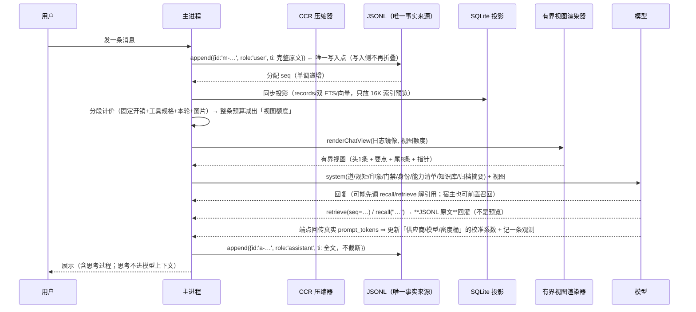

# 需求文档 · 记忆系统（WArmy）

> 状态：**已实现**（截至 v0.2.6；**第 44 轮后半改了预算口径**：预算 = 所有发给模型的内容、token 可校准、原文进日志、重启按会话分页 —— 见 §2 不变量表、§8、§9、§14）。
> 本文分两半：**上半是需求与流程**（用户视角：它应该怎么工作），
> **下半是技术实现**（工程师视角：代码在哪、数据长什么样、边界怎么守）。
> 关键代码：`packages/memory-os/`（记忆服务本体）、`packages/app-shell/src/memory-client.ts`（主进程客户端）、
> `packages/app-shell/src/context-renderer.ts`（有界视图渲染器）、`packages/app-shell/src/token-jiliang.ts`（token 口径与校准）、
> `packages/app-shell/src/yuSuan-jiage.ts`（整条请求分段计价与降级阶梯）、`archive-cleanup.ts`、`project-memory.ts`、`knowledge-base/`、`ccr-compressor/`
> 门禁：`verify-memory.mjs`、`verify-context-renderer.mjs`、`verify-history-persist.mjs`、
> `dev/gates/verify-r44-token.mjs`、`dev/gates/verify-r44-yuSuan.mjs`、`dev/gates/verify-r44-token-live.mjs`


---

# 第一部分：需求与流程（它该怎么工作）

## 1. 一句话定位

**记忆系统 = 一份只追加的本机日志（唯一事实来源）+ 一层可以随时丢掉重建的检索投影 + 一个"有界视图"渲染器。**
它保证三件事：**不丢**（历史永远在日志里）、**有界**（喂给模型的上下文永远不超过预算）、**可解引用**（被挤出去的内容还能被取回来）。

## 2. 产品层面的硬要求（不变量）

| # | 要求 | 为什么 |
|---|---|---|
| 1 | **只追加**：日志写入后不修改（唯一例外是用户显式回退到检查点） | "我说过的话"不能被悄悄改写；崩溃不丢已写内容 |
| 2 | **整条请求有界**（第 44 轮后半改口径）：预算 = **所有发给模型的内容**，不是只夹历史视图 | 旧口径下"预算设 2 万"实际发的是"2 万 + 一整套系统提示 + 工具规格" ⇒ 承诺没兑现 |
| 2b | **原文进日志**：写入侧不许折叠丢内容（有界发生在**投影**与**视图**，不在写入） | 真缺陷：`beforeLog` 先折叠 ⇒ 超长中段永久消失，`retrieve` 拿回半截还"命中成功" |
| 3 | **绝不给空视图** | 真事故：预算缩太小把 6 条历史全省略、只剩一根指针 ⇒ 模型说"这是咱们对话的第一条消息"，用户以为它失忆 |
| 4 | **指针必须完整可执行** | 被省略的内容要靠指针取回；半截指针等于取不回。**假 id 比没 id 更坏**（归档锚点曾经写 `seq:N` 这种不存在的 recordId） |
| 5 | **JSONL 是唯一事实来源**，SQLite 只是投影 | 投影坏了可重建；投影与日志冲突时**以日志为准**（所以 `retrieve` 优先读 JSONL 原文） |
| 6 | **写入者唯一**（`duty` / `router` / `memory-service` / `executor`） | 多路写 = 双源 = 同一句话显示两遍 |
| 7 | **权限先于相关性** | 检索先在作用域内过滤（这个会话/这个项目），再谈排序 |
| 8 | **CCR 只压投影/镜像/工具结果**，不压日志原文 | 见 #2b；工具结果是运行噪声，用户说过的话不是 |
| 9 | **宁可如实说"不可用"，也不编造**：服务没起来、向量模型缺失、投影缺行，一律如实上报并降级 | 假成功比失败更糟；"预算足够但被算成 0"也是一种假失败 |
| 10 | **主进程与渲染进程零原生 `.node` 依赖** | 记忆服务的原生依赖（better-sqlite3）只活在独立子进程里 |
| 11 | **token 不许猜**：口径唯一，校准精确到 `供应商 / 模型 / 密度桶`；无回读用平均法，一次都没有用先验 | 同一个模型挂不同供应商分词可能不同；中文与代码的"真实/估算"比值差一大截，共用一个数会超窗或假装装不下 |

## 3. 一次对话里，记忆发生了什么（流程）



**要点**：
- 日志写入在**发模型之前**（这样即使模型调用失败，用户那句话也已经落盘）。
- 工具结果**不进记忆**（只回模型，且有 4000/12000 字符限额）—— 记忆是"对话事实"，不是"运行噪声"。
- 助手回复**全文入库、不截断**（历史 bug 曾 `slice(0,4000)`，导致 retrieve 取不回尾巴）。
- 思考过程、系统小字、"本轮模型"这些**只给界面看**，永不进模型上下文。

## 4. 上下文不够用的时候怎么"记得住"

预算不够时，渲染器**不丢内容，只丢"逐字原文"**：把中间那段换成一段压缩要点 + **三种冗余线索的可执行指针**：

```
[省略 37 条 user/assistant，seq 11..48，共 8,412 字]
如需原文，可调用 retrieve(seq=11) / retrieve(recordId="m-1759…") / recall("<语义线索>") 取回原文。
```

- **seq 范围** → `retrieve({seq})` 精确命中（覆盖整段）
- **recordId 采样**（段首 4 + 段尾 4，最多 8 个）→ `retrieve({recordId})` 直取某条
- **语义线索** → `recall("…")` 语义/关键词召回

三种线索**故意冗余**：任何一条坏了，另外两条还能把内容取回来。

## 5. 归档与知识（长期记忆）

- 归档一个会话时，**不只是存一份摘要**，还要：抽取**实体/事件**进知识库、抽取**使用者偏好**（对"我"的长期认知）、生成**结构化摘要**（要点/决策/待办/风险）。
- 清理有明确上限（见 §13），不无限膨胀。

## 6. 优先级：谁的话最算数

`agents.md`（最高信念，用户可编辑）> 身份/模型/时间等 system 段 > **项目记忆**（项目规矩/目标，在值班者系统提示里）> 有界视图（对话历史）。

---

# 第二部分：技术实现

## 7. 数据分层（谁是什么）

| 层 | 位置 | 格式 | 角色 |
|---|---|---|---|
| **唯一事实来源** | `userData/memory/fast-memory.jsonl` | 一行一条 JSON（append-only） | 不可丢；seq 单调；**存整条原文**（第 44 轮后半） |
| **检索投影** | `userData/memory/memory.db`（WAL） | SQLite：`records` + `fts_uni` + `fts_tri` + `vec_index`（schema v2） | **可丢可重建**；`ti` 只放**前 16000 字符索引预览**（够找到，不够复述 ⇒ 原文走 JSONL） |
| **token 校准表** | `userData/token-calibration.json` | JSON，键 = `供应商/模型/密度桶`（另有 `@avg/桶` 平均法条目） | 让"预算 = 真实发送量"可兑现；5 秒节流写盘；**首次用到时才读** |
| **token 观测史** | `userData/token-observations.jsonl` | 一行一次供应商回读（供应商/模型/桶/上界/真实） | 归档时据此**离线重算**校准表；超 2 万条截断 |
| **服务运行时** | `userData/memory-runtime/`（`index.js`/`ipc.js`/`embedder.js`/`tokenizer.js`） | 编译产物副本 | 主进程 `fork` 它，避免打包路径问题 |
| **进程内镜像** | `chatLogs`（Map）+ 派生 `chatHistories` | 内存 | 界面与注入的快速读取；存**折叠预览**（有界），recordId 指向 JSONL 原文 |
| **归档** | `userData/archive/archives.jsonl` | JSONL | 摘要 + structured 要点 |
| **知识库（三层）** | `userData/knowledge/knowledge-{session,internal,private}.json` | 三份 JSON：实体（7 类）+ 事件（带证据锚点） | **私密=不可公开的个人与对人评价；内部=工作业务（含敏感业务与游戏娱乐等非隐私非个人）；会话=可对外公开、与业务无关、非敏感非个人**。读写各有一套作用域名单（§13.5） |
| **印象** | `userData/yinxiang.md`（旧名 `yonghushuju.md`，读之前自动改名一次）+ 每会话 `userData/impressions/<sid>.md` | Markdown（行式，上限 120 行 / 6000 字；注入截尾 3000 字） | 牛马对**所有牛马共用**的这位用户的长期理解（偏好、特别要求、只属于用户的信息），第 52 轮阶梯里位于**「规范」之后、「工具」之前**；**只留可以对外公开的形象** —— 敏感类目（健康/性向/宗教政治/财务法律/家庭亲密关系/身份账户/生育）不写印象，改投私密知识库，投不进就丢弃并记 `yinxiang.sensitive-skipped` |
| **规范** | `userData/guifan/<sessionId>.md` | Markdown（上限 4000 字） | **只作用于当前会话**的做事规范；优先级在术之后；第四列「规范」卡可编辑；归档时按它归置整理结果 |
| **认知** | 实例设置里的「写入认知」（`instances[].persona`） | Markdown（注入截尾 1600 字） | **这只牛马**的性格与背景（每只一份，让它们差异化）；注入在「束缚」之后、「身份/模型/时间」之前（第 52 轮阶梯倒数第二层）；互通时交给对方的也是这一份 |
| **检查点** | `userData/checkpoints/{checkpoints.json, shadows/<id>/}` | JSON + 快照目录 | 回退用（rollback 是**唯一允许改写日志**的例外） |
| **教条** | `userData/agents.md` | Markdown | 用户明说的长期指示；第 52 轮阶梯里位于 硬门禁/道/术/规范 之下、束缚之上 |

## 8. 写入路径（第 44 轮后半改口径：**原文进日志，折叠只发生在投影与镜像**）

```
用户消息：
  memory.append({id:'m-<ts>-<n>', sessionId, kind:'message', role:'user', ti: 完整原文})
  → 服务端 ++seq 落 JSONL（唯一事实来源，一字不丢）
  → 同步投影：records.ti / fts_uni / fts_tri 只放 **前 16000 字符的索引预览**（SUO_YIN_ZUI_DA_ZI）
  → 进程内镜像放 CCR 折叠预览（electron-main：beforeLog 只用于度量与镜像，不再决定落盘内容）
助手回复：同形状，role:'assistant'，**正文不截断**
工具结果：不进记忆（只回模型；受 4000 字/条、12000 字/轮限额 —— 这才是 CCR 该压的东西）
```

- **为什么不折叠了**：旧做法"CCR 压缩先于入日志"让超长的中段**永久消失**，`retrieve` 拿回来的就是半截，
  而且"命中成功"（第 44 轮后半用户 #7 点名的缺陷）。现在三层各司其职：
  **日志 = 不丢**、**投影 = 找得到（预览够索引）`、视图 = 装得下**。
- **`retrieve` 一律优先读 JSONL 原文**（`retrieveExact`：先 seq/id 命中 JSONL 索引，
  拿不到才退回投影，`via` 如实标 `sqlite:*-预览`）⇒ 不会"命中成功、内容半截"。
- **JSONL 索引增量维护**（用户 #8 的一半）：以前每次 `append` 把缓存置 null ⇒ 下一次 `retrieve`
  全文件重扫（6000 轮 × 2M 字符的日志上就是分钟级卡顿，还卡在用户等回复的路上）。
  现在 append 直接把新行的字节区间推进缓存；只有文件被外人改过（长度对不上）才重建。
- **角色还原契约**：SQLite 投影的 `tail()` **读不到** JSONL 里的额外字段，所以角色**只靠 recordId 前缀还原**（`a-…` = assistant，`m-…` = user；`memory-client.ts:510-522`）。重建历史时按前缀判定，不依赖投影。
- **seq 分配**：服务端 `meta.last_seq` 持久化计数（`index.ts:288,446`）；主进程用返回的 seq 对齐（`xiaYiLiaoTianXuLie(memSeq)`），服务不可用时退化为本地 +1。
- **去重**：同 `role + content` 且间隔 < 3 秒 ⇒ 跳过（同一句话有两条写入路径）；比的是**镜像里那份预览**（镜像存折叠预览），role 先归一成 `user`/`assistant`；recordId 带单调后缀，防同毫秒撞 UNIQUE id。
- **写入者白名单**：`duty | router | memory-service | executor`；**executor 写 `kind:'message'` 会被拒**（`index.ts:411-414`）—— 记忆里只有对话事实。
- **写入失败不挂 recordId**：宁可没有指针，也不要"指向不存在的记录"的假指针。**归档锚点同理**：
  以前 `session.summary` 的 anchors 写的是 `recordId: 'seq:N'` —— 一个**不存在的 id**，模型照抄只会取回空；现在用日志里真实的 `recordId`。

## 9. 读取路径（有界视图 + 整条请求预算）

**唯一入口**：`renderChatView()` → `xuanranYoujieShitu()`（纯函数、零 LLM、无副作用）。

### 9.1 预算怎么算（第 44 轮后半改口径：**预算 = 所有发给模型的内容**）

```
第 1 步  窗口与 token 预算（youPeizhiSuanShangXiaWenYuSuan）
  百分比   = settings.contextBudgetPercent（默认 60%，夹 10..100；上限可到 100%）
             并不低于 minPercent = ceil(2048 / 模型窗口 × 100)，也**不低于实测固定开销折算的下限**
  tokens  = max(2048, round(百分比 × 模型窗口))，再被"给输出留位"压到 窗口 − 输出上限
  字符天花板 20,000,000（旧的 20 万上限会把滑杆 62%–100% 压成同一个点）
第 2 步  token → 字符：**按本轮真实文字的构成折算**（见 9.2），不再乘那个万能 1.6
第 3 步  分段计价（yuSuan-jiage.jiageQingQiu）
  固定开销 = 把 shenFenTou 各段按【标签】切开逐段量（道/规矩/印象/门禁/身份/人设/能力清单/知识库/归档摘要/最近5条原文…）
  工具规格 = 与发送侧同一个入口 zuJingGongJuGuiGe 的结果（两份逻辑迟早漂移，抽出来了）
  本轮输入 = 只算**另外 push** 的内部续派指令（用户那句话本身在视图里，算两遍就是双重计费）
  图片     = 视觉 token（⚠️ 尚未接入计价，属于用户 #5 的待办）
第 4 步  分配（fenPeiYuSuan）
  视图额度 = max(预算×(1−5%), 固定+工具+本轮+图片+视图最小512)  ← 下限：不许"假装装不下"
             再被 窗口×(1−5%) 封顶                        ← 上限：抬也不许越窗
  视图 chars = tokenDaoZiFu(视图额度, 本轮样本, 该模型该桶系数)   ← 渲染层仍以字符工作
  审计 chat.budget.allocated：每段多大、生效预算、走了哪级降级，当场可查
```

**两条边界都有真机红过，别退回单条**：只讲"预算 = 全部内容"而不抬下限 ⇒ 32K 窗口模型上视图被算成 0（看起来有界，实际让模型失忆）；只抬下限而不被窗口封顶 ⇒ 偷偷超发。窗口真装不下固定开销时如实报 `chuangKouBuGou`，界面显示「固定开销 ≈N tokens 已超过该模型窗口」（`ctx.budget.overWindow`），并走阶梯到**停止发送**。

### 9.2 token 不再靠猜（第 44 轮后半 · 用户 #9，`packages/app-shell/src/token-jiliang.ts`）

修之前同一份内容有**三套互不相干的系数**在数（预算侧 `×1.6`、看板兜底 `÷3`、记忆服务里那套是 bge 的 WordPiece）。现在：

| 环节 | 做法 |
|---|---|
| 发送前 | 分脚本**紧上界**估算（CJK 0.78 / 拉丁 0.30 / 数字 0.45 / 空白 0.35 / ASCII 标点 0.60 / 其它 1.30）× **该模型该桶的校准比值** × 安全垫（1.15 + 桶内残余散布，封顶 +0.35） |
| 系数存哪 | `userData/token-calibration.json`，键 = **`供应商 / 模型 / 密度桶`** 三段（换供应商、换模型、换文字形状都不许混用）；**首次用到时才读盘**（顶层读会撞 const 的暂时性死区 ⇒ 表永远空却装作已校准） |
| 发送后 | 只认端点**原生**用量（`source==='native'`；OpenAI 兼容流式必须显式 `stream_options.include_usage` 才有）⇒ 用**同一条请求的上界**做分母更新 EMA（步长 0.3、限幅 [0.25, 2.5]）。**分母不许用"已放行的量"**，否则系数自我复合、换一次文字形状就追不上（真机 24 轮里 7 轮超窗） |
| 一次回读都没有 | 用**先验** `YAN_XIAN`（0.90–0.95，按桶；`wuCha=0` ⇒ 不凭空加厚垫子）—— 仍比旧的"万能 1.6"准 |
| 部分模型有回读 | `@avg/桶` 平均法条目：取该桶内样本 ≥3 的模型均值，误差取"最坏相对平均的超出比例" ⇒ 借平均值时安全垫自动覆盖最坏情况 |
| 归档时 | 每次回读都追加 `userData/token-observations.jsonl`；生成会话摘要时 `zhongSuanXiaoZhun()` 按全量观测**离线重算**整张表（在线 EMA + 离线重算两条腿），重算失败只记审计、不许把摘要判成失败 |
| 图片 | **含图请求不参与校准**（`token.calibrate-skip`）——视觉 token 还没接进预算口径，宁可少一个样本也不把系数带偏 |

### 9.3 渲染与降级

**渲染参数**：`keepHead = 1`（系统提示冻结，保 KV Cache 前缀稳定）、`keepTail = 8`（近期对话原文）、
要点最小份额 `DIGEST_MIN_SHARE = 25%`（否则"要点被头尾挤到只剩几十字符"= 有界成立但压缩白做）。

**视图内部的逐级降配顺序**（先牺牲谁，写在代码里）：
1. 先保"头尾 + 要点份额"的最优解（`total` 从大到小搜第一个满足的）；
2. 不行就降指针档位（`full` → `compact` → `min`）；
3. 再不行缩 `keepTail`，**最后**才缩 `keepHead`；
4. 仍然超 ⇒ `yingQianzhi()` 硬裁剪；
5. **硬断言**：`viewBytes ≤ budgetChars`（不允许抛错，用裁剪落地）；
6. **绝不给空视图**：日志非空 ⇒ 至少把最后一条真实消息带给模型。

**整条请求装不下时的降级顺序**（用户 #4 点名，`yuSuan-jiage.fenPeiYuSuan` 返回动作清单）：
① 摘要「最近 5 条 user 原文」（视图额度 < 2048 token 就触发）→ ② 本轮输入自己超长 ⇒ 摘要本轮原文 →
③（有图）降分辨率 → 减张数 → ④ 收缩视图 → ④·5 压可压缩段 + 工具面 12→6 截尾 → ④·6 让出我们自己留的余量 →
⑤ 仍不够 ⇒ **停止发送**（触发项目异常系统：警告音按勾选、显示「继续/重试」、写出具体原因；`{ tingZhi: … }` 由收缩重试壳带出，
外层排在 `contextTooSmall` 兜底**之前**判，否则具体原因会被吞成一句"上下文太小"）。逐级细节见 §16.5 与 ADR002 §11.4。

**指针结构**（`zhizhenQianzhui`）：`[省略 N 条 <角色>，seq A..B，共 X 字]` + 三线索；
`ElidedRange.recordIds` 是**有界采样**（段首 4 + 段尾 4，上限 8），完整性由 seq 范围 + recall 保证 —— 否则渲染代价随日志条数线性放大。

**上下文超限自动收缩**：模型报 context 类错误时按 `1.0 → 0.6 → 0.35 → 0.2` 相对预算重试（`daiShangXiaWenChongShiYunXing`），到底仍失败则**如实告知**"该模型上下文太小"，不再无限重试。

## 10. 记忆服务本体（memory-os）

- **进程**：主进程 `fork(userData/memory-runtime/ipc.js)`，用**捆绑 Node**（`nodePath`），env 传 `WARMY_MEMORY_DIR`；
  启动超时 10 秒；**stdout/stderr 必须有人读**（不然管道写满 64KB 会把子进程卡死在写操作上，启动必超时）——读进**有界 12 行**缓冲，退出时写进启动日志，便于看崩溃原因。
- **协议**：`{id, op, …}` → `{id, …}`（child_process IPC）；方法：`append / tail / recall / recall_sync / retrieve / rebuild / vector_status / hydrate / stats / embed / shutdown`。单次调用 8 秒超时。
- **索引三通道**（RRF 融合，k=60）：
  | 通道 | 分词 | 擅长 |
  |---|---|---|
  | `fts_uni` | CJK 字符间插空格 → 单字索引（`unicode61`） | 1–2 字的短查询 |
  | `fts_tri` | trigram（≥3 字符才可查） | ASCII 标识符/错误码/路径、≥3 字 CJK 子串 |
  | `vector` | bge-small-zh-v1.5（ONNX int8, 512 维，纯 WASM） | 语义相近但用词不同 |
  - 向量**可选**：没有模型文件就跳过这一腿并**如实报因**；余弦下限 0.5（实测分界：真实语义查询 top1≈0.68、乱码≈0.447）；query 的 `[UNK]` 占比 > 0.5 也跳过（此时稠密向量不可信）。
- **权限先于相关性**：作用域先物化成 `TEMP` 表 `scope_filter_<fnv1a>`，三个通道都 `JOIN` 它。
- **fail-closed**：服务未就绪/不可用 ⇒ 工具返回**可读的说明文本**、绝不抛错；模型因此知道自己"取不到"，而不是被喂空数据。投影缺行时回读 JSONL 原文（`971-995`）。

## 11. 模型可用的两个解引用工具

| 工具 | 参数 | 说明 |
|---|---|---|
| `recall` | `{ query, limit ≤ 20 }` | 语义+关键词召回，返回**卡片**（命中片段 + 出处） |
| `retrieve` | `{ recordId 或 seq, offset?, maxChars ≤ 8000 }` | 精确取回原文（`huiTui: exact/nearby/fuzzy`） |

- 单次结果上限 **4000 字符**（`JIYICANG_GONGJU_JIEGUO_ZISHU`），一次最多 **20 张卡**，query 最长 **8000 字符**。
- **回灌形式**：卡片列表 + 一句提示；**非 exact 命中会强制告警**（告诉模型"这是附近/模糊匹配，不是原文"）—— 不许把"相似"说成"就是"。
- **作用域（第 48 轮补的不变量 #9「权限过滤先于相关性」）**：外部群（群里有别人）里，模型自己调的 `recall` 走 `recallScoped({groupId})`、
  `retrieve` 也带同一作用域（memory-os 解引用时按与召回**同一条谓词**判，作用域外的精确命中也不交出去）⇒ 拿着别处的 seq/recordId 也取不到私聊原文；
  查不出群类型时**收窄**到本会话而不是放开。单聊与内部项目只有你一个人 ⇒ 不加作用域（跨会话"永远记得"是承诺的一部分）。
  宿主的前置召回一直按 `sessionId` 作用域。门禁 `verify-r48-qiyue.mjs` ⑦。

## 12. 项目记忆与最高信念

- **项目记忆**：事实源是 `GroupRecord.project.memory`（`groups.json`）；读取上限 8000 字，**注入上限 1200 字**（超限明确标注截断）；注入到值班者的系统提示与执行者 `contextItems`。
- **最高信念**：`userData/agents.md`，在 chat-send 路径**强制注入为首条 system** 并声明最高优先级。**未确认**：群/值班路径是否也注入（调研未在那些分支看到注入点）。

## 13. 归档、知识与清理

| 项 | 触发/上限 |
|---|---|
| 归档 | `warmy:guiDangWaiBu`；会话摘要 `warmy:huiHuaZhaiYao` 取**末 30 条** |
| 提取 | 纯规则（regex，零 LLM）：实体/事件/偏好 + 要点/决策/待办/风险 |
| 落点 | `archive/archives.jsonl`、`knowledge/knowledge.json`、`yinxiang.md`（印象：按行去重，上限 120 行 / 6000 字，超出丢最旧） |
| 检查点 | 默认保留最近 **20** 个（可配），硬上限 50 个 / 512MB |
| 语音文件 | 超过 **7 天**清理 |
| 审计日志 | 由用户显式"清空" |

### 13.5 知识库：结构、类型、怎么用（第 52 轮定稿）

**一个库 = 三份 JSON**（同一目录，按信任级分开存）：`knowledge-session.json` / `knowledge-internal.json` / `knowledge-private.json`。

**里面放两种东西**（都是结构化事实，不是对话流水）：

| 类型 | 字段 | 用途 |
|---|---|---|
| 实体 `Shiti` | id / kind / ming / attrs / eventIds / anchors / updatedAt | "东西是什么"。`kind` 七类：person 人、org 组织、material 资料、place 地点、concept 概念、tool 工具、project 项目 |
| 事件 `ZhishiShijian` | id / biaoTi / tool / method / result / expected / entityIds / anchors / ts | "发生过什么"：标题 + 用了什么工具 + 怎么做 + 结果 + 期望，挂在实体上 |
| 证据锚点 `anchors` | recordId + seq | 指回 `fast-memory.jsonl` 的**原文**（知识库只存事实，原文永远可以 retrieve 回来） |

**三层的语义**（唯一口径在 `zhi-shi-fen-ceng.ts` 的头注释）：

- **私密库 private** —— 不可公开的：用户本人的健康/财务法律/家庭身份/性向/宗教政治/生育/身份账户，以及**对人对事的评价**（"某人不可靠"这类）。
- **内部库 internal** —— 工作与业务：项目、报价、交付、供应商、打包部署，以及游戏娱乐等"非隐私但也非个人形象"的内容。
- **会话库 session** —— 可以对外公开的：与业务无关、非敏感、非个人特性的内容。牛马互通信封与外部渠道能看到的就是这一层。

**读的作用域**（`kbLayersFor`）：单聊/本牛马实例按 `privateKb` 开关决定能不能看私密层；项目群 = 内部 + 会话；外部群聊 = 只会话；联系人/未知会话 = 只会话。
**写的作用域**（`kbWriteLayers`）：与读分开判（能读不等于能写），实例可写三层、项目写内部+会话、外部群只写会话。

**第 52 轮加的两道机制**：

1. **写入口按内容升层**：模型/用户传来的 `layer` 只是"想放哪"，内容的敏感度决定"必须放哪" —— 两者取更严的那个
   （`kbWritable(sessionId, 想写的层, 内容)`）。判成私密却写不进私密层 ⇒ 直接拒，并如实说明"这条内容比本会话能写的层更敏感"。
   审计 `kb.layer-raised` / `kb-layer-denied`。（口径：判漏 = 泄露，升过头 = 群聊写不进任何工作话题 —— 所以业务判据只认硬标志。）
2. **内部库 → 会话库的脱敏概要**（新功能）：归档写完内部库后，从这批内容里**派生**一份可对外的概要写进会话库。
   概要**不是改写原文**，而是从 12 条**能力白名单**里挑条目（"我们可以做网页小游戏的开发与验收"这个级别）；
   挑不出就**整条抑制**。写之前必过确定性检查器四道关：白名单（逐条 + 剥离固定句式后不许残留一个字）、
   禁现形态（数字/金额/日期/路径/联系方式/存在性说法"做过·何时·怎么做"/专名指向）、哨兵 canary、长度 ≤240 字。
   过 ⇒ `kb.tumin-written`，不过 ⇒ `kb.tumin-suppressed` 并**不写**。
   为什么不靠"让模型改写一遍再打码"：摘要本身就是泄露面（成员推断、风格反推属性、被抹数字可重建），业界结论是降密要用
   **上下文之外的确定性检查器**（FlowSeal / IFC 的 no-read-up），只做 paraphrase 必然漏。

**归档后整理**（`zhi-shi-zheng-li.ts`）：同标题且内容实质相同 ⇒ 判重复，留最新；同标题不同内容 ⇒ 判前后矛盾，留新说法；
标题 >60 字或结果 >500 字 ⇒ 截断。只在真有改动时记 `kb.tidy`（含逐条理由）。空库、唯一条目库一律不动。

**模型怎么用**（注入里的触发器，第 40 轮起）：提到某人/某项目/某工具而上下文里没有来历、要对"以前定过的事"下结论、
需要结构化属性、或用户明确问"我们以前是不是说过" ⇒ 先 `knowledge_query`；命中就引用并写明来自知识库，
**没命中就如实说"知识库里没有这条"**，绝不拿猜测当事实；值得沉淀再 `knowledge_add`。

### 13.6 知识库的双时间（第 53 轮项 5）
每条知识带两个时刻：**记录时间**（这条信息什么时候被说出来 —— 写一次不再改，是"你什么时候告诉我的"那条轴）
与**发生时间**（事情本身发生在什么时候，**只有原文写了才填**，相对日期以说话时刻为锚）。
查询某个时间点时**两轴同时查**、命中轴标注出来并参与排序（调研：时间条件做成事后过滤会把 temporal 召回从 50% 打到 37.5%）；
发生时间缺失时明写"未记录：**不许拿记录时间顶替**"。旧说法被新说法**取代不删除**（打 shiXiaoTs），
派生的对外概要带血缘 yinZi ⇒ 源被取代则重算，重算不过一起退场。判据在纯模块 shi-jian-shuang.ts，门禁 verify-r53-shijian。

### 13.7 知识库可靠性三件套（第 53 轮项 4，纯模块 zhi-shi-ke-kao.ts）
1. **实体归一三层裁决**：同 kind 才比；person·org·project 是保护类型 ⇒ 只有归一后完全同名才自动合并，只是"很像"一律新建 + 交复核
   （kb.entity-review 留痕）。相似度 = bigram 重合系数 × √长度相近度（认得"简称⊂全称"，又不把 张三/张三丰 并成一个）。
2. **证据闸（evidence-before-belief）**：写**事件**前要么带锚点、要么是宿主派生来源、要么与**本轮用户原话**连续重合 ≥10 字，否则拒写
   （kb.evidence-denied）并给可执行补救。证据只比用户原话 —— 拿模型自己的输出当依据等于让猜测自我印证。
3. **陈旧降权不删除**：按**发生时间**算半衰期 90 天、下限 0.35；检索结果挂〔陈旧 N 天〕，含糊措辞挂〔待核〕。
   **命中轴相同**时陈旧度参与排序（三年前的旧事不许压过最近说法）；时间命中仍是第一关键字。
4. **写时去重与取代**：同层 + 同标题（忽略空白/大小写）+ 有共同实体 ⇒ 同内容 NOOP 不重复写（`kb.write-noop`）、
   异内容旧说法取代不删除（`kb.superseded-on-write`）、新说法带 `quDaiIds`（与 `yinZi` 的"我由谁派生"分开）。
   判据是确定性的（不调模型裁决），代价是只认"同标题"的冲突，跨标题的同义说法交给归档整理。
阈值与名单只住这一份（主进程再抄一份就是下一个不一致的源头）。门禁 verify-r53-zhishi（44 条 + 15 个变异全抓）。
## 14. 崩溃恢复（第 44 轮后半：**按会话分页**）

- 冷启动重建：库空而 JSONL 有 ⇒ 全量重建投影；恢复内存镜像走 `tailPerSession(每会话 120 条, 最近 60 个会话)`。
- **为什么不再用全局 `tail(400)`**（用户 #6）：按 seq 倒序取 400 条 ⇒ 一个高频会话能把整窗占满，
  **其它会话重启后直接失忆**（界面上消息还在，镜像里没有 ⇒ 模型看不到，用户也不知道要手动让它回忆）。
- 额度分配：单会话 ≤20 万字符、全局 ≤120 万字符，并且"还剩几个会话就分几份"、每会话至少保住 2 万字符；
  服务端不支持该 op 时**如实退回**全局 tail 并把 `fangShi` 写进 `chat.history.restore` 审计（不许静默降级）。
- 更早的历史**不常驻内存**，只能靠指针 `retrieve` 取（取回的是 JSONL 原文，不是预览）。
- 记忆服务崩了/起不来：**对话照常可用**（只是模型暂时没有解引用能力），并且启动日志里能查到子进程最后 12 行输出。

## 15. 相邻机制（同属"别忘事"的一族）

- **CCR 压缩**：现在只管三处 —— 工具结果（`tool_result`）、进程内镜像/视图侧、以及"这条有多大"的度量；
  **不再折叠日志原文**（见 §8）。规则型、零 LLM。
- **read-back 回读**：写后回读校验，不匹配**不许说"已保存"**。
- **资产治理**：会话产生的文件/附件按 project/session 检索（`zhuCeLiaoTianZiChan`）。
- **检查点回退**：全量快照 + 可 rollback 回写日志 —— 与"只追加"**存在张力**，属**显式例外**（用户主动回退才发生）。回退前备份 `fast-memory.jsonl.bak-<ts>`，回退后追加 `kind:'rollback'` 标记（含回退点 id / 时间 / 备份路径），全程持 `JsonlSuo`。

## 16. 已知风险 / 未接线（如实记录）

1. ~~`records.groupId / entityType` 列已建，但 `append` **从未传值**~~ **已修（v0.2.9）**：聊天/补写路径的 `append` 均带 `groupId`（项目/会话 id）与 `entityType`（`chat` / `manual`）；作用域过滤可按项目精细检索。
2. ~~`lock.ts` 的 `JsonlSuo`（SWMR 文件锁）**已导出但未实例化**~~ **已修（v0.2.9）**：`JiyiCangFuwu.append` 写 JSONL 时持锁；检查点回退共用同一 `.lock` 协议。
3. ~~检查点回退会改写 `fast-memory.jsonl` ⇒ 与"只追加"不变量冲突~~ **已收窄为可审计例外（v0.2.9）**：备份 + `kind:'rollback'` 标记 + 写锁；除此之外仍严格只追加。
4. ~~写入侧 CCR 折叠丢原文~~ **已修（第 44 轮后半 · 用户 #7）**：JSONL 存完整原文、投影存 16K 索引预览、`retrieve` 一律优先 JSONL；真机断言"21624 字符的消息在日志里一字不差、镜像只有 12040 且等于同一份原文过 CCR 的结果"。
5. ~~归档锚点用假 id（`recordId: 'seq:N'`）~~ **已修（第 44 轮后半 · 用户 #7，第 45 轮补净）**：会话摘要用日志里真实的 `recordId`；**外部群归档**那条残留的 `recordId: \`seq:\${a.seq}\`` 也改成了空串 —— 解引用侧本来就有 `if (anchor.recordId)` 的回落，留空串会自然退回 `seq` 线索，而假 id 会把"查得到"伪装成"查不到"。门禁：`verify-r44-yuSuan.mjs` ⑫ 之后那条"锚点宁缺不假"（源码级 + 回落两侧都在）。
6. ~~重启恢复全局共享 400 条~~ **已修（第 44 轮后半 · 用户 #6）**：按会话分页（§14）。
7. ~~**#5 图片细则**未做~~ **已做（第 45 轮）**：
   - **计入预算**：视觉 token 按**真实像素**算（`shiJueToken(宽,高,模型)` × `SHI_JUE_JIA_JIA=1.2` 安全加价），
     像素由 `nativeImage` 当场解出来，与图块**同序**存在 `tuCheJi` 里（续接轮靠会话缓存带走）；不按文件字节猜 ——
     同一张图存 PNG 还是 JPEG 字节能差 10 倍，模型吃的补丁数却一样。
   - **上限**：单轮 `TU_ZHANG_SHANG_XIAN=8` 张；单张解码前 `TU_MEI_ZHANG_ZI_JIE=6MB`、规范化后 `TU_DATA_URL_ZI_SHU=8M` 字符。
     超限的**逐张登记**进"未喂给模型的附件"，不静默截断。
   - **能力分流**：唯一判据 `moXingKeyiKanTu(modelId)`（探测事实 → 官方规格表 → 只按文本），
     在"要不要转交"与"合并图片块之前"各用一次；判不过就当众剥图并记 `chat.images-blocked-by-capability`。
     只计**真的会进请求**的那些图（转成文字的图不重复收费）。
   - **分次发送**：`keYiFenCi()` 两道判断 —— ① 单张 + 固定开销放得下；② 本轮文字**没有**跨图对比需求
     （命中 `对比/哪张/差异/前后/vs/compare…` 就不分）。分得了才 `tuFenCiKanTu()` 按批发给同一个模型，
     每批失败都如实写明第几批、哪几张。
   - **阶梯**：分次 → 降分辨率（`tuXiaoShao()` 真的缩到最长边 ≤1024）→ 减张数 → 收缩视图 → **停止发送**；
     停止走项目异常系统（`biaoRenWuZhongDuan` ⇒ 警告音按用户勾选 +「继续 / 重试」按钮 + 决策卡 + 台账），
     原因里带上窗口、各段大小、还差多少、能怎么办。
   - **校准**：带图的轮不再整轮跳过 —— 先按同一套算法算出图片的视觉 token，从供应商回读里**扣掉**，
     剩下的才拿去校准文字系数（`token.calibrate-image-split`）；估得比整条回读还大时才跳过并说明原因。
8. ~~**#8 另一半：宿主前置召回**未做~~ **已做（第 45 轮）**：装配阶段用本轮内容 `recallScoped(…, 3, {sessionId})` 先取一轮，
   拼成 `【前置召回 · 宿主按本轮内容主动取回的历史线索】` 注入。三条硬约束：**份额有界**（≤3 条、每条 ≤200 字、整段 ≤本轮预算 6%，夹在 600–2400 字）、
   **先记账再渲染**（这段在计价**之前**进 `shenFenTou`，视图拿的是扣掉它之后的余额）、**不许拖住这一轮**（未就绪/800ms 超时/报错都按"没召回"，
   并留 `chat.pre-recall-skipped` / `chat.pre-recall-failed` 原因）；`settings.preRecall=false` 可关，关掉也留痕。
9. **已做（第 45 轮）** **#10 摘要自身不膨胀**：注入点不再是"末 8 条 → 截 3000 字"，改走 `zhai-yao-he-bing.ts`：
   最近的逐条保留、更早的**合并去重**成一段、**总量与归档条数无关**（100 条也只吃这一份份额），
   装不下的条数**写在正文里**（`〔另有 M 次归档没有被放进这段上下文：仍在归档里，用 recall("关键词") 取〕`），
   份额随本轮预算缩放（`jiYaoFenE`：8%，夹在 1200–8000 字），审计说清"注入几条/共几条/几条没覆盖/用了多少份额"。
   ⚠️ 仍**没有**"摘要再被摘要"的**离线**分层归档（合并只发生在注入时，无状态）：这是有意选择 —— 不在磁盘上造第二份事实源。
10. **未做**：**单条超大输入的"摘要 + 指针"** —— 第 45 轮把"本轮原文过长"接进了阶梯（`JIANG_JI.ZHAIYAO_BENLUN` 真的摘要并留下
    `recall("开头")` 指针），但**渲染层内**的 `yingQianzhi` 硬裁剪仍存在于单条超长工具结果那一侧；两者口径不同（一个是发送前摘要，一个是视图内裁剪），下一轮统一。

## 16.5 第 45 轮新增的三条不变量（都有门禁）

| 不变量 | 内容 | 落点 |
|---|---|---|
| **注入量恒定** | 视图渲染**之后**才拼上去的那一段（步骤账本 + 子模型结果 + 分次看图描述）有**常数份额**：账本 ≤4000 字、注入层 ≤6000 字，且这两份在计价时按 `daiRu` 预留、注入时按同一上限截断 | `yuSuan-jiage.ts:DAI_RU_CENG_ZUI_DA_ZI/ZHANG_BEN_ZUI_DA_ZI`、`electron-main.ts` 的 `daiRuShangXian()/he` 截断、门禁 ⑨ |
| **执行者上下文 = O(任务规模)** | 马尔可夫毯有**两道闸**：单条 ≤3000 字（超出留"按序号回原文里取"的指针）、总长 ≤12000 字（超长的条目**整条丢掉**并如实计数）；群里的用户原话进毯前也设闸（第 48 轮：切口给前缀与提示留位，否则提示会被毯的单条闸切掉）；任务黑板只进有界摘要（≤2400 字） | `executor.ts:shouZhanBian()`、`orchestrator.ts:gouJianZhanBianXiang()`、`hei-ban.ts:heiBanZhaiYao()`、多执行者回复走 `zheng-liu.ts` 公平配额；门禁 ⑨ + `verify-r48-heiban` ⑦ |
| **两条路径同一个口径** | 群/值班路径的视图额度不再等于整条预算：`contextBudgetChars()` 也走 `fenPeiYuSuan` 扣实测固定开销；`ZUI_XIAO_JI` **按两侧取大**（被较小的测量冲掉就等于少扣 ⇒ 顶窗） | `electron-main.ts:contextBudgetChars/zuiXiaoJiDangQian`、`chat.budget.duty-measured`、门禁 ⑨ |

**窗口不足时的第④·五级**（新增，排在"停止发送"之前）：固定开销自己就装不进窗口时，先动**允许动**的部分 ——
① 可压缩的 system 段按同一比例截短（**道/规矩/印象/产品门禁/身份锚一条都不许动**），
② 还不够就把这一轮的工具面按 12→6 截尾（记忆双刀与干活工具优先，自定义长尾先让路，且**当场告诉模型**本轮工具被收窄；
同一条通知在上下文里只留一份 —— 这一级可能连走两趟，真机审计里抓到过两条一模一样的 `本轮工具面收窄=79`），
压完仍装不下才停。缺口一律按 `fp.shengXiaoTokens`（分配器实际用的那条上限）算，不拿裸窗口算。

**第④·六级「让出余量」**（`yuSuan-jiage.ts:rangChuYuLiang()`，只让一次，审计 `chat.budget.give-back-reserve`）：
真机上"装不下"往往不是内容太多，而是**我们自己留的垫子太厚** —— 2% 窗口安全垫 + 输出预留（长文 12288）+ 5% 执行余量。
让法：安全垫让完、输出预留退到地板 `max(2048, 窗口×4%)`（模型还得有话可说，剩下的交给续派）、执行余量退到 2%。
敢让的依据：预算用的是**分脚本上界**估算，实测真实/上界 ≈0.64（中文）–0.89（代码），上界本身已比 2% 垫子厚 ⇒ 让垫子 ≠ 超发；
让完仍装不下照样走第⑤级停止发送（`rengQue` 写进审计）。
⚠️ **让了必须两边一起让**：发送侧的 `maxTokens`（`yunXuShuChu`）也要夹到同一个留位数（审计 `chat.budget.output-cap-lowered`），
地板两边同源 `SHU_CHU_LIU_WEI_DI_BAO = 2048`（也是思考模型 thinking 的保底）—— 只放宽输入不降输出，输入 + 输出照样顶穿窗口。
真机事故（`verify-history-persist` 第 [1] 段两条红的真因）：模型窗口未知 ⇒ 兜底窗口偏小 ⇒ 道 + 工具顶满 ⇒ `stop-send` 缺 3356 token，
整轮什么都没发；让出 10895 token（留位 12288→2048、可装输入 19825→30720）后同一轮正常发完。

**归档锚点只有一个构造口径**（`guiDang-maidian.ts`，用户 #7）：`recordId` 只能**逐字来自**日志里真实存在的 id，
拿不到就留**空串**（解引用侧 `if (anchor.recordId)` 回落 seq 线索），**绝不许派生**（旧写法 `'seq:' + n` 是个不存在的 id，
模型照抄 `retrieve` 只会取回空）。`maidianWeiFan()` 是这套口径的不变量自检（假 id / 派生 id / 假 seq / 缺文件名），
门禁拿它跑真值表（含旧写法作反例），不再靠"源码里搜不到某个字面"证明。

## 16.6 第 48 轮：执行者这一侧的记忆（任务黑板 + 蒸馏全文）

记忆库里新增两种**只追加**的记录，和会话消息同一份 JSONL、同一套投影（FTS 不分 kind），区别只在 `kind`：

| kind | 谁写 | recordId | 内容 | 能怎么取 |
|---|---|---|---|---|
| `blackboard` | 宿主替执行者写（来源宿主盖章；写入者 = `executor`，宿主补记的问题 = `duty`） | `hb-<任务号>-<序号>` = 条目 id | `〔任务黑板 rw-… · 决定〕主题：内容 · 路径 … · 替代 … · 来源 某某` | `recall(任务号/关键词)`、`retrieve(recordId)`；执行者在本轮里用 `heiban_read` |
| `worker` | 宿主（执行者结论超长时） | `wk-<任务号>-<执行者 id>` | 完整结论 + 全部事实/决定/待决/自报产物（一字不截） | 回复里给的 `retrieve(recordId="wk-…")` 指针 |

三条硬约束（门禁 `verify-r48-heiban.mjs` ③④）：
- **写成功才算数**：记忆服务回 `ok:true` 才标"已存档"、才给 retrieve 指针；记忆服务没起/超时/回 `ok:false` ⇒ 条目只在本轮可见、不给指针，回复里如实说"未能存档"；成败都写审计（`group.heiban` / `group.heiban-fail` / `group.zhengliu-quanwen(-fail)`）。
- **不混进聊天重放**：重启按会话分页只取 `kind='message'` ⇒ 黑板与全文存档召回得到、取得回，但不会被当成聊天消息重放、也不占重启名额。
- **写入者约束不放宽**：执行者身份照旧**不能**写 `message`（memory-os `append` 的写入者白名单），黑板没给执行者开写聊天流的后门。

进执行者上下文的**不是**整块黑板，而是有界摘要（≤2400 字，按"冲突 > 未决 > 决定 > 产物 > 事实"取最近几条 + 取回指针）：
黑板 200 条（原文 11 万字）时摘要 2335 字、10 条时 1484 字 ⇒ 执行者上下文仍是 O(任务规模)，与历史长度无关。

## 17. 验收（门禁在断言什么）

| 门禁 | 断言的主题 |
|---|---|
| `verify-memory.mjs` | 静态：三路召回都在、唯一事实源、env 传递；动态：`append → recall(sync/async) → retrieve → rebuild → 作用域隔离 → 写入者白名单拒绝`；**无原生 sqlite 时如实 skip（skip ≠ 缺陷）** |
| `verify-context-renderer.mjs` | 解耦（视图大小与日志长度无关，方差 0）、恒 ≤ 预算、三线索指针、`recordId/seq/recall` 三条路都能**逐字节**取回原文、`keepHead/keepTail` 保真、200 字极端预算退化、预算扫描 / 脏输入 / 压缩器抛错都不抛、真 Electron 跑 24 轮、`metrics.viewBounded` |
| `verify-history-persist.mjs`（**live 档**，2026-10-19 编入清单；此前不在任何一档里 ⇒ "原文不丢"从来没被验收遍覆盖过） | 唯一写入点、镜像与 JSONL 对齐（**新口径**：短消息逐字节一致；超长消息 JSONL 必须是完整原文 + 镜像必须是 ≤16K 的折叠预览且等于同一份原文过 CCR 的结果）、重启重建（maxSeq 一致、角色由 id 前缀还原）、注入内容逐字节包含旧消息、新 seq 严格递增、**记忆服务坏掉仍能对话**（且不挂假 recordId）。当前读数 **failures=0** |
| `verify-r44-yuSuan.mjs`（fast，第 44 轮后半新增 · 第 45 轮 12 段 · 本轮 **16 段 170 条**） | ①固定开销按【标签】可算可切段、②整条成本分项相加（工具规格不许漏算）、③视图额度精确等式、④**抬下限不许假装装不下 / 窗口封顶不许偷偷超发**、⑤降级顺序（#4 点名的 ①②③④⑤ + ④·5 压缩 + **④·6 让出余量**）、⑥脏输入不抛、⑦溢出保护（窗口 − 2% 安全垫 − 本轮输出预留，输出预留只有一个算法）、⑧**图片 #5**（张数上限、按像素计价、逐张价表、挤掉视图额度、分次两道判断、只给能看图的模型、停止走异常系统）、⑨**定稿要点**（迟注入层是预算里的一段且有常数上限、马尔可夫毯两道闸、两条路径同口径、**锚点走纯函数真值表**）、⑩**窗口不足先压可压缩段**（工具面截尾计价与发送同一个数、停止真的结束这一轮）、⑪**宿主前置召回**（有界份额、计价前入账、超时不拖轮、可关并留痕）、⑫**摘要不膨胀**（注入量与归档条数无关、未覆盖条数写在正文里、份额随预算缩放）、⑬预算算术只有一份、⑭**产物审计**（说"已写入 X"就必须真有 X，否则判口头执行）、⑮**设置字段对账**（写进 settings.json 的顶层键必须都在 `YingYongPeizhi` 里声明过）、⑯**云端风控拒绝不是回答**（短样板话才判、调过工具不判、不写历史、原地重试一次再换模型；群/值班路径同一判据；文案走 10 包翻译、原文里的 `$&` 不被吃掉） |
| `guiDang-maidian.ts`（纯模块） | 归档锚点的唯一构造口径 + 不变量自检；被 ⑨ 直接 import 跑真值表（真 id 逐字用 / 缺 id 留空串 / 无 seq 不当锚点 / 旧写法 `seq:N` 必须被判红） |
| `verify-r44-token.mjs`（fast，第 44 轮后半新增） | 分脚本紧上界（每类密度都必须高于模拟供应商的真实密度）、EMA 收敛/限幅/脏样本拒收、**比值分母 = 未校准上界**、三条腿（精确→平均→先验）且**绝不跨桶借**、借平均值时桶内最坏也不超窗、观测史离线重算、24 轮闭环 0 超窗（负向对照：跨桶借会把真实放到 1.38 倍预算）、口径唯一的静态不变量 |
| `zhai-yao-he-bing.ts`（纯模块，无门禁文件） | 归档摘要的合并/去重/份额算法；被 ⑫ 直接 import 断言（100 条归档与 8 条归档的注入量一样、重复行只出现一次、`jiYaoFenE(0)=0`） |
| `verify-r44-token-live.mjs`（live，同轮新增） | 真 Electron + 真模型：原生回读进校准（键带供应商域名与密度桶）、表落盘且跨重启一致、**删表后预算按公式回到先验档**、中文/代码会话同预算折算出不同字符数、**真实 prompt token ≤ 生效预算**（"设多少发多少"的正面兑现）、固定开销超过窗口时如实报、归档真的重算 |
| `verify-r48-heiban.mjs`（fast，第 48 轮新增） | 任务黑板（只追加/来源盖章/冲突/有界摘要）、蒸馏（jiao_fu → json → 正文三档、硬上限、超长存档 + 指针、产物核实、公平配额）、落盘工厂 × 真记忆服务（存进、recall 找到、retrieve 取回、重开还在、不混进重放）、编排器端到端（假模型）、队列冲刷同协议、三层缓存顺序、20 万字原话仍 O(任务规模) |
| `verify-r48-qiyue.mjs`（fast，第 48 轮新增） | 契约 v1.1：每个类型有消费点或标【未落地】、包外无同名定义、本包无值、运行时返回值（recall 卡片 / retrieve / 看板 / 检查点 / 蒸馏 / 执行者报错）⊇ 契约必填字段、错误分类真值表 |
