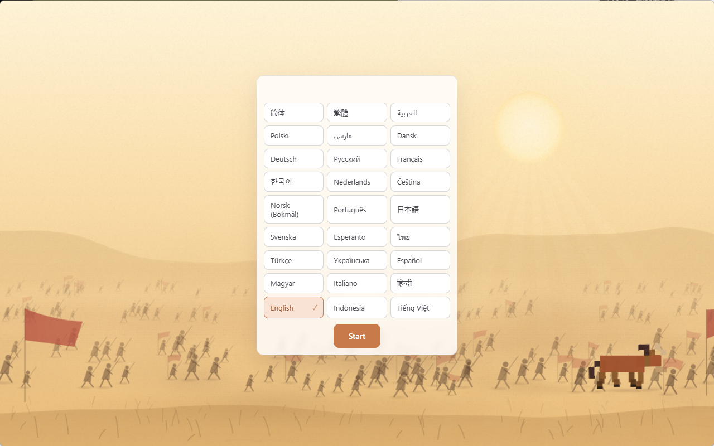

# 无限牛马 · WArmy 使用说明书

> 你不是指挥牛马的将军，你是**将将者**——指挥那些指挥牛马的人。
> 一支只属于你的牛马军队（复数）。本地优先、无服务端账号、隐私优先、可扩展、可隔离、可多设备连接、可多人组织、可多人多智能体互动。
> 它不会越用越谄媚，只会越用越高效。

---

## 一、它是什么

WArmy 是一个把 AI 当作**团队**而非聊天框的桌面工作区。你给每只牛马一个角色、一套人设、一个模型；值班智能体分派工作；共享看板保存计划与产物；本地记忆服务记住发生过的事，并在**思考链中召回**——没有"上下文压缩"这种悄悄丢弃历史的机制。

- **本地优先**：聊天、文件、记忆、设置都在你的磁盘上，没有 WArmy 云、没有 WArmy 账号。模型自带（本地/自建/云端），费用直接付给你的供应商。
- **隐私优先**：无分析、无广告 SDK、无静默上传。密钥走系统安全存储。联网、搜索、IM 适配默认关闭，开了才用。
- **只在需要时说话**：没有喋喋不休、没有一问一答的乒乓。桌面桌宠安静而主动，有价值才开口。
- **越用越高效**：自我总结、自我改造、自我进化以**高效与正确**为目的，而非迎合你。内置改造手册，让你的智能体改造自己——朝向有用，而非谄媚。

## 二、三种用法

| 你想要 | WArmy 给你 |
| --- | --- |
| **私人助理** | 一只牛马，带你的文件、工具、模型。读、搜、写、跑命令，危险动作先经你批准。 |
| **私人专家团队** | 产品、开发、评审、写作。值班智能体路由需求，看板记录决策，记忆传递上下文。 |
| **共享项目室** | 人与智能体同处一个项目。角色、审批、产物、留痕；可选 LAN/DHT/中继组网。 |

一个人可以三种都用。小团队可以从助理起步，长成项目室，而无需把_work_搬上托管平台。

## 三、里面有什么

- **多智能体互动与协作**：牛马彼此对话、交接、共享黑板。智能体平权——没有谁悄悄独占真相。
- **桌面桌宠**：可自定义外形（桌宠开发中，功能未完善），会与桌面图标互动、走到图标旁、做出反应。摄像头/麦克风/扬声器/网络逐项可开关。
- **harness 自我进化**：A/B 支线实验、提示词自更新、预测自收敛、回退点。对着证据自我改进，任何合并都可回退。
- **知识库、计划表、回退点**：决策与产物随项目保存；每个声称写出的文件都先在磁盘上核验。
- **迪文系统（Diwen）**：事实的结构化机器层表示（目前仅中文部分可用）。用户可见内容恒为自然语言。迪文是独立开源项目（见致谢）。
- **像同事一样工作**：自然地使用社交软件，与同事和下属一起工作——只是这次下属是智能体。邮件通知、提示音、定时任务。
- **可扩展**：兼容 **dsh 插件系统**、可装 **skill**、可接 **MCP**。插件可自带设置、自更新、提供确定性（非模型裁量）扩展点。
- **nm 查看器**：Markdown 源码/预览、Office/PDF 抽取、二进制逐字节编辑、压缩包浏览、多标签浏览器（分栏、自主浏览）。

## 四、值得一试的场景

- **发布说明工厂**："从这三个文件起草发布说明，再让评审核对每条声明。"开发写、评审读真实文件、看板记录通过项。
- **会记住的调研**：搜网、抓页、读 PDF、归档。下周按指针召回来源，而非重贴整段对话。
- **安静的夜班**：定时导出、长任务监控。留审计轨迹，需要你时带理由停下，不伪造进度。
- **真正的第二意见**：不同人设、不同模型的评审，给你真正的第二意见，而非同一答案的重跑。
- **本地且私密**：把模型指向 `127.0.0.1`，模型永不离开你的机器。

## 五、控制与安全

- **危险动作先批准**：shell 命令、工作区外写入、受保护目录、其他会话数据，都停在授权卡。每次工具调用都审计。
- **授权按会话**：群聊牛马不能因为能聊天就浏览项目或私人会话。授权档位按会话独立选择，非全局。
- **可选隔离**：牛马跑在宿主或容器；容器不可用如实报告，绝不悄悄替换。
- **诚实对待局限**：未完成的路径明说；不可用的服务大声失败，而非编造结果。

## 六、安装与使用

**下载、安装、即用。** 无账号、无服务端配置。

1. 打开[最新发布](https://github.com/Pondsi/WArmy/releases)，下载 `WArmy-Setup-<版本>.exe`。
2. 运行安装器，选择目录，启动 **WArmy / 无限牛马**。
3. 首启：选语言、建身份、保存 24 词助记词。添加模型供应商，创建第一只牛马。

数据存于安装目录下的 `WArmyData`，升级/卸载保留。安装器未签名（SmartScreen 可能提示）；发布页列 SHA-256 供校验。

**环境要求**：Windows 10/11 x64；一个模型端点（本地服务器、OpenAI 兼容、或 Anthropic）。本地模型先启动服务器再填 base URL，服务器不需要密钥时密钥栏留空。搜索/云模型/IM 需联网，其余可离线。

**27 种界面语言**：简体中文 · 繁體中文 · English · 日本語 · 한국어 · Русский · Español · Français · Português · Esperanto · Deutsch · Italiano · Nederlands · Polski · Svenska · Čeština · Magyar · Dansk · Norsk bokmål · Türkçe · Українська · Bahasa Indonesia · Tiếng Việt · ไทย · हिन्दी · العربية · فارسی。

## 七、状态与诚实

核心工作流已用本地模型服务器经连续离线门禁轮次 + 首启/搜索/索引/懒加载检查验证。macOS、物理 4K、真实 IM 账号、云供应商仍在验证。账号级多设备记录同步是下一里程碑（当前可选项目间组网已可用）。应用解锁时多数工作区文件为明文；云供应商会收到你发送的内容。模型输出可能出错——交付前请核对产物。

WArmy 不声称"不可破解"或持有安全认证。目标更窄且可测：**默认本地、危险先批准、触界即诚实。**

## 八、致谢

WArmy 站在开源工作之上。完整传递依赖树及各包许可见 `pnpm-lock.yaml` 与包清单。

- **DeepSeek Harness (dsh)** — MIT — [deepseek-ai/deepseek-harness](https://github.com/deepseek-ai/deepseek-harness)。WArmy 捆绑 dsh 运行时用于可选 dsh 执行路径，并兼容其插件系统。
- **迪文（Diwen）** — 见其自身许可 — [Pondsi/dsh-diwen](https://github.com/Pondsi/dsh-diwen)。独立开源项目：事实的结构化、可验证机器层表示。WArmy 集成迪文（目前仅中文部分可用）做机器层结构化；用户可见内容恒为自然语言。迪文亦以 `diwen` 发布于 npm。感谢其作者与贡献者。
- **Electron**（MIT）、**Chromium**（BSD-3-Clause）、**Node.js**（MIT）、**TypeScript**（Apache-2.0）、**pnpm**（MIT）、**electron-builder**（MIT）。
- **SQLite**（Public Domain，含 FTS5）、**better-sqlite3**（MIT）、**better-sqlite3-multiple-ciphers / SQLCipher**（MIT/BSD-style，可选记忆加密）。
- **ONNX Runtime Web**（MIT，可选本地向量）、**sherpa-onnx**（Apache-2.0，可选本地语音）、**@node-rs/jieba**（MIT，迪文可选中文分词）、**DuckDB**（MIT，可选本地分析）。
- **qrcode-generator**（MIT，© Kazuhiko Arase）、**jsQR**（Apache-2.0）。
- **Ollama**、**ComfyUI**、**LibreOffice**、**WPS / Office** 等为可选外部服务，非捆绑代码，各自许可与条款适用。
- 其余依赖各自保留版权与许可。再分发 WArmy 请保留上游声明与许可文本。

**无限牛马**是中文名。像素牛是吉祥物。干活才是重点。

## 九、文档与许可

- [README.md](./README.md)：英文介绍。
- [LICENSE](./LICENSE)：MIT，原版、改版、代码片段，自用或分发均须署名 **Pondsi** 并附上仓库链接 <https://github.com/Pondsi/WArmy>。
- [SPONSORS.md](./SPONSORS.md)：支持项目。
- [Issues](https://github.com/Pondsi/WArmy/issues)：报障与需求。