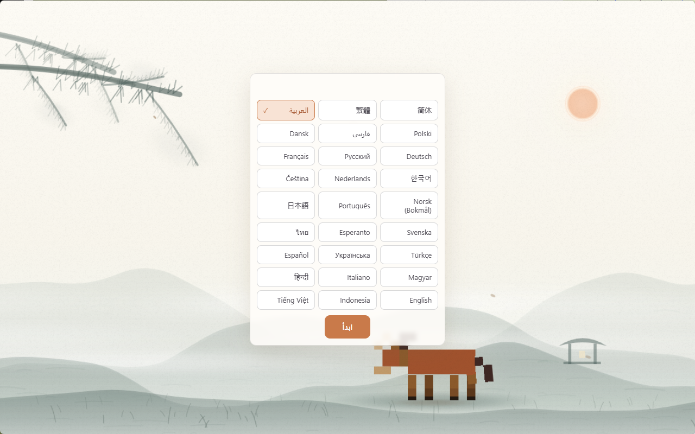
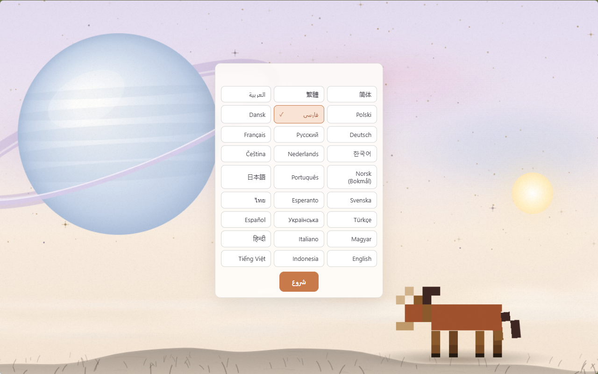
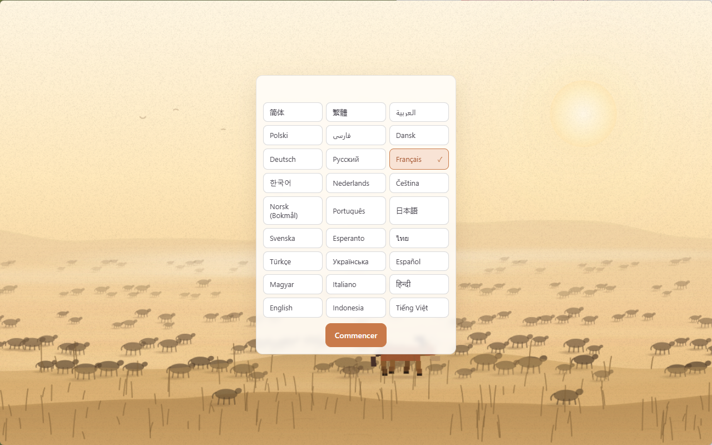

# 无限牛马 · WArmy 使用说明书

> 你不是指挥牛马的将军，你是**将将者**——指挥那些指挥牛马的人。
> 一支只属于你的牛马军队（复数）——**属于你的军团**（Workhorse Army）。本地优先、无服务端账号、隐私优先、可扩展、可隔离、可多设备连接、可多人组织、可多人多智能体互动。
> 它不会越用越谄媚，只会越用越高效。

---

## 一、它是什么

WArmy 是一个把 AI 当作**团队**而非聊天框的桌面工作区。你给每只牛马一个角色、一套人设、一个模型；值班智能体分派工作；共享看板保存计划与产物；本地记忆服务记住发生过的事，并在**思考链中召回**——没有"上下文压缩"这种悄悄丢弃历史的机制。

- **本地优先**：聊天、文件、记忆、设置都在你的磁盘上，没有 WArmy 云、没有 WArmy 账号。模型自带（本地/自建/云端），费用直接付给你的供应商。
- **隐私优先**：无分析、无广告 SDK、无静默上传。密钥走系统安全存储。联网、搜索、IM 适配默认关闭，开了才用。
- **只在需要时说话**：没有喋喋不休、没有一问一答的乒乓。桌面桌宠安静而主动，有价值才开口。
- **越用越高效**：自我总结、自我改造、自我进化以**高效与正确**为目的，而非迎合你。内置改造手册，让你的智能体改造自己——朝向有用，而非谄媚。

## 二、三种用法

| 你想要 | WArmy 给你 |
| --- | --- |
| **私人助理** | 一只牛马，带你的文件、工具、模型。读、搜、写、跑命令，危险动作先经你批准。 |
| **私人专家团队** | 产品、开发、评审、写作。值班智能体路由需求，看板记录决策，记忆传递上下文。 |
| **共享项目室** | 人与智能体同处一个项目。角色、审批、产物、留痕；DHT 组网默认加入（设置可关），LAN/中继可选。 |

一个人可以三种都用。小团队可以从助理起步，长成项目室，而无需把_work_搬上托管平台。

## 三、里面有什么

- **多智能体互动与协作**：牛马彼此对话、交接、共享黑板。智能体平权——没有谁悄悄独占真相。
- **桌面桌宠**：可自定义外形（桌宠开发中，功能未完善），会与桌面图标互动、走到图标旁、做出反应。摄像头/麦克风/扬声器/网络逐项可开关。**设备仲裁**：会话使用麦克风/扬声器/摄像头时优先于桌宠——桌宠让出、会话用完归还后桌宠恢复；多个会话争用时激活窗口优先。
- **harness 自我进化**：A/B 支线实验、提示词自更新、预测自收敛、回退点。对着证据自我改进，任何合并都可回退。
- **知识库、计划表、回退点**：决策与产物随项目保存；每个声称写出的文件都先在磁盘上核验。
- **迪文系统（Diwen）**：事实的结构化机器层表示（目前仅中文部分可用）。用户可见内容恒为自然语言。迪文是独立开源项目（见致谢）。
- **像同事一样工作**：自然地使用社交软件，与同事和下属一起工作——只是这次下属是智能体。邮件通知、提示音、定时任务。
- **可扩展**：兼容 **dsh 插件系统**、可装 **skill**、可接 **MCP**。插件可自带设置、自更新、提供确定性（非模型裁量）扩展点。
- **nm 查看器**：Markdown 源码/预览、Office/PDF 抽取、二进制逐字节编辑、压缩包浏览、多标签浏览器（分栏、自主浏览）。
- **A2UI 互动回复**：普通回复先出现，稳定后再附加可勾选清单、表单等互动内容。聊天三点菜单叫「回复增强」；入口是最终回复旁的马头：未勾选时字体色，生成中自下而上主题色波纹，就绪后主题色，点击打开产物（优先 nm 查看器，未启用 nm 时用系统默认浏览器，右键提供相反方式）。进化开启或关闭都可用，双臂各绑自己的产物。产物留在当前会话工作区。
- **Computer Use（默认关闭）**：连接外部 MCP 服务器后，只开放列窗口、截图、点击、键入、拖拽、滚动六类能力；敏感动作每次单独确认，不开放 shell、文件管理或进程管理。

## 四、值得一试的场景

- **发布说明工厂**："从这三个文件起草发布说明，再让评审核对每条声明。"开发写、评审读真实文件、看板记录通过项。
- **会记住的调研**：搜网、抓页、读 PDF、归档。下周按指针召回来源，而非重贴整段对话。
- **安静的夜班**：定时导出、长任务监控。留审计轨迹，需要你时带理由停下，不伪造进度。
- **真正的第二意见**：不同人设、不同模型的评审，给你真正的第二意见，而非同一答案的重跑。
- **能勾选的清单**："给我一份可勾选的发布清单，并留备注位置。"普通文字先给出答案，开启「回复增强」后点马头打开互动层。
- **本地且私密**：把模型指向 `127.0.0.1`，并关闭不需要的联网功能，模型请求即可留在本机。

## 五、控制与安全

- **危险动作先批准**：shell 命令、工作区外写入、受保护目录、其他会话数据，都停在授权卡。每次工具调用都审计。Computer Use 使用独立授权，完全授权档也不会自动放行桌面控制。
- **授权按会话**：群聊牛马不能因为能聊天就浏览项目或私人会话。授权档位按会话独立选择，非全局。
- **可选隔离**：牛马跑在宿主或容器；容器不可用如实报告，绝不悄悄替换。
- **诚实对待局限**：未完成的路径明说；不可用的服务大声失败，而非编造结果。

## 六、安装与使用

### 安装方法

**下载、安装、即用。** 无需云服务器；账号为本地自托管（24 词助记词自己保管），日常 PIN/系统解锁无感使用，仅在预测到风险时才要求登录验证。

1. 打开[最新发布](https://github.com/Pondsi/WArmy/releases)，下载 `WArmy-Setup-0.4.50.exe`（当前已发布版本；更新资产以发布页为准）。
2. 运行安装器，选择目录，启动 **WArmy / 无限牛马**。
3. 首启：选语言、建身份、保存 24 词助记词。添加模型供应商，创建第一只牛马。

数据存于安装目录下的 `WArmyData`，升级/卸载保留。安装器未签名（SmartScreen 可能提示）；发布页列 SHA-256 供校验。

### 使用方法

- 给每只牛马设角色/人设/模型链；值班智能体分派工作；看板记录决策与产物。
- 危险动作（shell、工作区外写入、受保护目录、他人会话）停在授权卡；授权档位按会话独立。
- 桌面拟态可触摸/语音互动；中间与最终回复自动朗读（可在三点菜单「阅读回复」或桌面右键「静音」关闭，两处同一开关）。
- nm 查看器打开文件后右键可「复制文件路径 / 打开文件所在目录」。

**环境要求**：Windows 10/11 x64；一个模型端点（本地服务器、OpenAI 兼容、或 Anthropic）。本地模型先启动服务器再填 base URL，服务器不需要密钥时密钥栏留空。搜索/云模型/IM 需联网，其余可离线。

**27 种界面语言**：简体中文 · 繁體中文 · English · 日本語 · 한국어 · Русский · Español · Français · Português · Esperanto · Deutsch · Italiano · Nederlands · Polski · Svenska · Čeština · Magyar · Dansk · Norsk bokmål · Türkçe · Українська · Bahasa Indonesia · Tiếng Việt · ไทย · हिन्दी · العربية · فارسی。

## 七、优点与同类产品

### 优点

- 本地优先、隐私默认：无云账号、无静默上传；密钥走系统安全存储。
- 记忆可查：append-only 日志为真相源，思考链内召回，不悄悄丢历史。
- 危险先批准、触界即诚实：审计全量工具调用；不可用大声失败。
- 越用越高效而非谄媚：A/B 支线对着证据自我进化，可回退。

### 同类产品

与单聊天框助手、托管多智能体平台相比：WArmy 把团队、看板、记忆、审批放在**你自己的磁盘**上；模型自带、费用直付供应商；组网/搜索/IM 默认关闭、开了才用。不声称“不可破解”，目标更窄且可测。

## 八、技术要点

- Electron 主进程 + 渲染层工作区 + 独立子进程跑原生活（SQLite/FTS5、分词、分析、本地语音）；主/渲染**零原生模块**。
- 本地记忆/服务端口 **59599**（仅回环）；DHT 组网默认加入（设置→网络与主机可关），只发布地址/端口/指纹/在线时间，聊天内容永不进发现层；LAN/中继组网可选。
- 拼音命名 IPC；27 种界面语言；按会话授权；容器不可用如实报告。
- 兼容 dsh 插件系统、skill、MCP；扩展点确定性，不给模型宿主裁量权。

## 九、记忆系统

L0 append-only jsonl → L1 印象 → L2 记忆子进程 → L3 知识库。`recall` 找锚点、`retrieve` 按指针解引用回原文；总结摘要注入上下文并附可执行取回指针。记忆可查、可核、可回退，不靠“上下文压缩”悄悄丢历史。

## 十、状态与诚实

核心工作流已用本地模型服务器经连续离线门禁轮次 + 首启/搜索/索引/懒加载检查验证。macOS、物理 4K、真实 IM 账号、云供应商仍在验证。账号级多设备记录同步是下一里程碑（当前可选项目间组网已可用）。应用解锁时多数工作区文件为明文；云供应商会收到你发送的内容。模型输出可能出错——交付前请核对产物。

WArmy 不声称"不可破解"或持有安全认证。目标更窄且可测：**默认本地、危险先批准、触界即诚实。**

## 十一、致谢

WArmy 站在开源工作之上。完整传递依赖树及各包许可见 `pnpm-lock.yaml` 与包清单。下列每一项均附上游项目链接。

**随包运行时与界面**

- **Electron**（MIT）<https://github.com/electron/electron> —— 桌面壳；**Chromium**（BSD-3-Clause）<https://github.com/chromium/chromium> —— 渲染引擎；**Node.js**（MIT）<https://github.com/nodejs/node> —— 运行时，随包 node.exe 独立进程跑记忆服务。
- **three.js**（MIT）<https://github.com/mrdoob/three.js> —— 拟态 3D 渲染；**@pixiv/three-vrm**（MIT）<https://github.com/pixiv/three-vrm> —— VRM 形象加载（许可文本随 vendor 包附带）。
- **hash-wasm**（MIT）<https://github.com/Daninet/hash-wasm> —— 纯 WASM 的 argon2id/哈希。
- **franc-all**（MIT）<https://github.com/wooorm/franc> —— AI 输出语种检测（连同 **trigram-utils**、**collapse-white-space**、**n-gram**，均 MIT）。
- **DeepSeek Harness (dsh)**（MIT）<https://github.com/deepseek-ai/deepseek-harness> —— 捆绑 dsh 运行时用于可选 dsh 执行路径，并兼容其插件系统。随包 dsh 伴随依赖：**@nanmicoder/dsh-agent-teams** <https://www.npmjs.com/package/@nanmicoder/dsh-agent-teams>；**node-pty**（MIT）<https://github.com/microsoft/node-pty>；**koffi**（MIT）<https://github.com/Koromix/koffi>；**protobufjs**（BSD-3-Clause）<https://github.com/protobufjs/protobuf.js>；**@google/genai**（Apache-2.0）<https://github.com/googleapis/js-genai>。
- **迪文（Diwen）** —— 见其自身许可 <https://github.com/Pondsi/dsh-diwen> —— 独立开源项目：事实的结构化、可验证机器层表示；用户可见内容恒为自然语言；亦以 `diwen` 发布于 npm。感谢其作者与贡献者。
- **SQLite**（Public Domain，含 FTS5）<https://www.sqlite.org/>；**better-sqlite3**（MIT）<https://github.com/WiseLibs/better-sqlite3>；**better-sqlite3-multiple-ciphers**（MIT）<https://github.com/m4heshd/better-sqlite3-multiple-ciphers>；**SQLCipher**（BSD-style）<https://github.com/sqlcipher/sqlcipher> —— 可选记忆加密；**bindings**（MIT）<https://github.com/TooTallNate/node-bindings> 与 **file-uri-to-path**（MIT）<https://github.com/TooTallNate/file-uri-to-path> —— 原生加载链（仅子进程）。
- **DuckDB**（MIT）<https://github.com/duckdb/duckdb> 与 **@duckdb/node-api**（MIT）<https://github.com/duckdb/duckdb-node-neo> —— 可选本地分析（仅子进程）。
- **ONNX Runtime Web**（MIT）<https://github.com/microsoft/onnxruntime> —— 可选本地向量（WASM SIMD/WebGPU）。
- **sherpa-onnx / sherpa-onnx-node**（Apache-2.0）<https://github.com/k2-fsa/sherpa-onnx> —— 可选本地语音（仅子进程）。
- **qrcode-generator**（MIT，© Kazuhiko Arase）<https://github.com/kazuhikoarase/qrcode-generator>；**jsQR**（Apache-2.0）<https://github.com/cozmo/jsQR>。

**构建与安装器**

- **TypeScript**（Apache-2.0）<https://github.com/microsoft/TypeScript>；**pnpm**（MIT）<https://github.com/pnpm/pnpm>；**electron-builder**（MIT）<https://github.com/electron-userland/electron-builder>；**esbuild**（MIT）<https://github.com/evanw/esbuild>；**NSIS**（zlib/libpng 风格）<https://nsis.sourceforge.io/> —— Windows 安装器引擎。

**按需子进程工具**（不随包；经您同意才下载/安装，哈希固定）

- **whisper.cpp**（MIT）<https://github.com/ggml-org/whisper.cpp> —— 可选本地语音转文字。
- **TripoSR**（MIT）<https://github.com/VAST-AI-Research/TripoSR> —— 单图→mesh 的 3D 捏脸；跑在 **PyTorch**（BSD-3-Clause）<https://github.com/pytorch/pytorch> 与 **Python**（PSF 许可）<https://www.python.org/> 上；模型权重取自 **Hugging Face** <https://huggingface.co/> ，各模型许可自行适用。
- **Docling**（MIT）<https://github.com/docling-project/docling> —— 版面/表格保真文档解析。
- **Tree-sitter / web-tree-sitter**（MIT）<https://github.com/tree-sitter/tree-sitter> —— WASM 子进程增量 AST 解析。

**协议与可选外部服务**（非捆绑代码，各自许可与条款适用）

- **A2UI**（Apache-2.0）<https://github.com/a2ui-project/a2ui> —— 官方 `@a2ui/agent`、`@a2ui/lit`、`@a2ui/web_core` 支撑可选互动回复层。
- **Model Context Protocol** <https://modelcontextprotocol.io/> —— 随包 mcp-bridge 插件实现 MCP stdio JSON-RPC 契约，把外部 MCP 服务器变成普通 agent 工具。
- **Ollama**（MIT）<https://github.com/ollama/ollama>；**ComfyUI**（GPL-3.0）<https://github.com/comfyanonymous/ComfyUI>；**LibreOffice**（MPL-2.0）<https://www.libreoffice.org/>；**WPS / Office**（专有）<https://www.wps.com/> —— 可选模型服务器或创作/办公工具。
- 其余依赖各自保留版权与许可。再分发 WArmy 请保留上游声明与许可文本。

**无限牛马**是中文名。像素牛是吉祥物。干活才是重点。

## 十二、文档与许可

- [README.md](./README.md)：英文介绍。
- [LICENSE](./LICENSE)：Pondsi 署名许可——唯一使用条件是署名 **Pondsi**；原版、改版、代码片段，自用或分发均适用。不强制附仓库链接，也不强制保留许可全文。第三方依赖、模型权重与素材仍各自适用其原许可。
- [SPONSORS.md](./SPONSORS.md)：支持项目。
- [Issues](https://github.com/Pondsi/WArmy/issues)：报障与需求。

---

署名：Pondsi（+mimo-X-pro-Preview +mimo-v2.5-pro +DeepSeek-V4.1-Flash +Qwen3.7-max +Qwen3.8-27b +Gemini3.1pro +Gemini3.8-flash）

本说明书由 Xiaomi MiMo Desktop 自行提交。